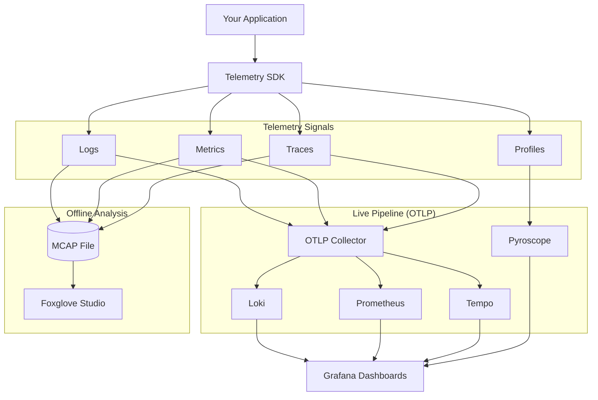
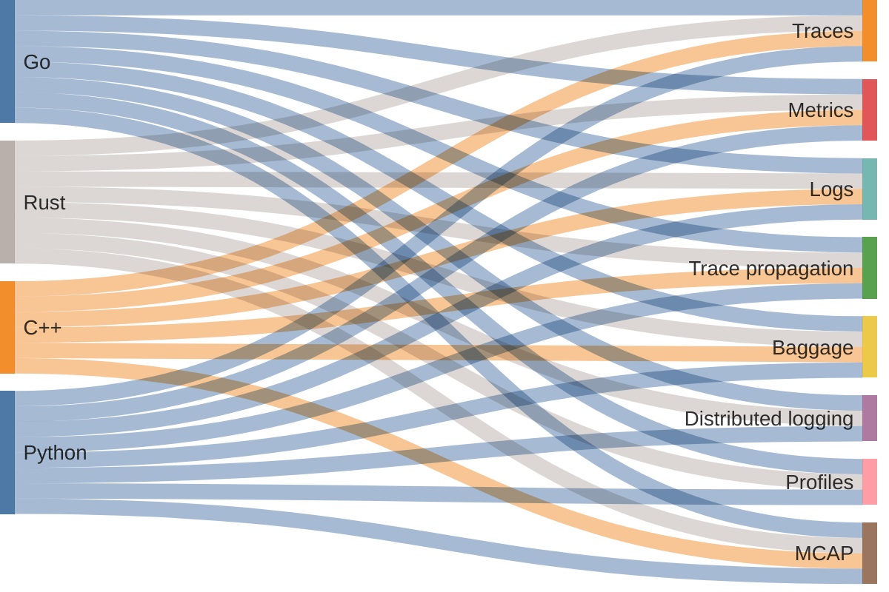
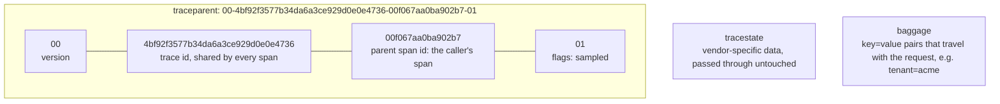

<!-- markdownlint-disable MD041 -->
<h1 align="center">Telemetry</h1>

<p align="center">
  <strong>One framework, every signal.</strong> Telemetry is a unified,
  config-first observability framework for Go, Python, Rust, and C++ — structured
  logging, metrics, distributed tracing, and continuous profiling, built on
  OpenTelemetry standards and shipped with a batteries-included Grafana stack.
</p>

<p align="center">
  <a href="https://github.com/the-protobuf-project/telemetry/actions/workflows/ci.yaml"></a>
  <a href="https://github.com/the-protobuf-project/telemetry/actions/workflows/linter.yaml"></a>
  <a href="LICENSE"></a>
  
  
  
  
</p>

## Contents

- [Overview](#overview)
- [Features](#features)
- [Architecture](#architecture)
- [Language support](#language-support)
- [Configuration — `telemetry.toml`](#configuration--telemetrytoml)
- [Environment variables](#environment-variables)
- [Telemetry signals](#telemetry-signals)
- [Tracing across languages](#tracing-across-languages)
- [Writing at high volume](#writing-at-high-volume)
- [Observability stack](#observability-stack)
- [Repository layout](#repository-layout)
- [Development](#development)
- [Releases](#releases)
- [Use cases](#use-cases)
- [Contributing](#contributing)
- [License](#license)

## Overview

Telemetry is a comprehensive observability framework that provides unified
telemetry across languages. Instrument your code once with a single fluent API and
get structured logging, distributed tracing, metrics collection, and continuous
profiling — exported over standard OTLP and, optionally, recorded to MCAP for
offline analysis in Foxglove Studio.

Every SDK shares the same mental model: build an `Telemetry` instance from a
config file or code, then use the logger, metrics, and tracer it exposes. The same
`telemetry.toml` drives all four languages.

## Features

- **Structured logging** — context-aware logging with automatic trace correlation.
- **Per-module log levels** — fine-grained verbosity control per service or module.
- **Metrics collection** — counters, histograms, and gauges with OpenTelemetry.
- **Distributed tracing** — end-to-end request tracking across service boundaries.
- **Continuous profiling** — production performance analysis with Pyroscope.
- **MCAP recording** — a single file for offline analysis in Foxglove Studio.
- **Config-first** — auto-discovers `telemetry.toml`; TOML, YAML, JSON, and
  environment-variable overrides are all supported.
- **Zero-config defaults** — sensible defaults get you running with no setup.
- **OpenTelemetry native** — standard OTLP protocols for maximum compatibility.

## Architecture



## Language support

Four first-class SDKs share one configuration format and one API shape. Expand a
language for installation and a quick start.

| Language | Status | Minimum version | Documentation |
| -------- | ------ | --------------- | ------------- |
| Go       | Stable | 1.25            | [telemetry-go](telemetry-go/README.md) |
| Python   | Stable | 3.12            | [telemetry-py](telemetry-py/README.md) |
| Rust     | Stable | 1.91            | [telemetry-rs](telemetry-rs/README.md) |
| C++      | Beta   | C++17           | [telemetry-cpp](telemetry-cpp) |

<details>
<summary><strong>Go</strong></summary>

```bash
go get github.com/the-protobuf-project/telemetry/telemetry-go
```

```go
package main

import "github.com/the-protobuf-project/telemetry/telemetry-go"

func main() {
    // Auto-discovers telemetry.toml or uses defaults.
    p, err := telemetry.New().
        WithService("my-service", "1.0.0").
        Build()
    if err != nil {
        panic(err)
    }
    defer p.Close()

    p.Logger.Info("Service started")
}
```

See the [Go SDK documentation](telemetry-go/README.md).

</details>

<details>
<summary><strong>Python</strong></summary>

```bash
pip install "git+https://github.com/the-protobuf-project/telemetry.git#subdirectory=telemetry-py"
```

```python
from telemetry import Telemetry

# Auto-discovers telemetry.toml config.
with Telemetry.new().build() as o:
    o.logger.info("Service started")
    o.logger.warning("Rate limit approaching", {"percent": 85})
```

See the [Python SDK documentation](telemetry-py/README.md).

</details>

<details>
<summary><strong>Rust</strong></summary>

```toml
[dependencies]
telemetry = { git = "https://github.com/the-protobuf-project/telemetry.git" }
tokio = { version = "1", features = ["macros", "rt-multi-thread"] }
anyhow = "1.0"
```

```rust
use telemetry::{Telemetry, Environment, logger};

#[tokio::main]
async fn main() -> anyhow::Result<()> {
    // Auto-discovers telemetry.toml config.
    let _telemetry = Telemetry::new()
        .with_service("my-service", "1.0.0")
        .environment(Environment::Production)
        .build()?;

    logger::info!("Service started");
    Ok(())
}
```

See the [Rust SDK documentation](telemetry-rs/README.md).

</details>

<details>
<summary><strong>C++</strong></summary>

Add the module dependency in your `MODULE.bazel`:

```starlark
bazel_dep(name = "telemetry.cpp", version = "1.0.0")
```

```cpp
#include <telemetry/telemetry.hpp>

int main() {
    auto o = telemetry::Telemetry::builder("my-service", "1.0.0")
        .environment(telemetry::Environment::Development)
        .build();

    TELEMETRY_LOG_INFO("Service started");
    o.metrics().counter("requests_total", 1.0);

    auto span = o.tracer().start_span("process_request");
    span.set_attribute("user_id", "12345");
    span.end();
}
```

See the [C++ SDK sources and examples](telemetry-cpp).

</details>

## Configuration — `telemetry.toml`

All SDKs auto-discover `telemetry.toml` from your project root:

```toml
[service]
name = "my-service"
version = "1.0.0"
environment = "development"

[telemetry.otlp]
endpoint = "otel.example.com"   # Port 4317 auto-added
auth_token = "your-token"

[logging]
level = 2                        # Global log level (1=Error, 2=Info, 3=Debug)

[logging.modules.nats-module]
level = 1                        # Override: Error only for this module
```

**Precedence** (lowest to highest): Defaults → `telemetry.toml` → `.env` /
`TELEMETRY_*` environment variables → code.

See the full [Configuration Guide](docs/configuration.md).

## Environment variables

Every config key can be overridden with an `TELEMETRY_`-prefixed environment
variable. Nesting is expressed with a single underscore in Go, Rust, and C++, and a
double underscore in Python.

| Language        | Prefix            | Nesting            | Example |
| --------------- | ----------------- | ------------------ | ------- |
| Go / Rust / C++ | `TELEMETRY_` | `_` (single)       | `TELEMETRY_TELEMETRY_OTLP_ENDPOINT` |
| Python          | `TELEMETRY_` | `__` (double)      | `TELEMETRY_TELEMETRY__OTLP__ENDPOINT` |

```bash
export TELEMETRY_SERVICE_NAME=my-service
export TELEMETRY_TELEMETRY_OTLP_ENDPOINT=otel.example.com:4317
export TELEMETRY_LOGGING_MODULES_VISION_LEVEL=3
```

## Telemetry signals

| Signal      | What you get |
| ----------- | ------------ |
| Logging     | Structured, context-aware logs with trace correlation and per-module levels. |
| Metrics     | Counters, histograms, and gauges exported over OTLP. |
| Tracing     | Distributed spans with attributes and events across service boundaries. |
| Profiling   | Continuous CPU/memory profiling delivered to Pyroscope. |
| MCAP        | Unified recording of signals to an MCAP file for Foxglove Studio. |

### Every signal, every language

Each band is one signal an SDK supports, so a language's width is how much of
the framework it covers and a signal's width is how many SDKs have it. The
table below gives the API for each, and what is still missing.



| Signal | Go | Rust | Python | C++ |
| ------ | -- | ---- | ------ | --- |
| Traces → OTLP | Yes | Yes | Yes | Yes (OTLP export added; was MCAP-only) |
| Metrics → OTLP | Yes | Yes | Yes | Yes |
| Logs → OTLP | Yes | Yes | Yes | Yes |
| Trace context across services (W3C `traceparent`) | Yes: `Inject` / `Extract` | Yes: `inject` / `extract` | Yes: `inject` / `extract` | Yes: `inject` / `extract` |
| Baggage | Yes: `SetBaggage` / `Baggage` | Yes: `set_baggage` / `baggage` | Yes: `set_baggage` / `get_baggage` | Yes: carried through `extract` → `inject` |
| Distributed logging (logs carry the trace id) | Yes: `InfoContext(ctx, …)`, `Logger.WithContext` | Yes: inside `span.attach()` | Yes: inside `start_span` | No (not yet) |
| Profiles → Pyroscope | Yes: `WithProfiling` | Yes: `with_profiling` (`profiling` feature) | Yes: `with_profiling` (`[profiling]` extra) | No (not yet) |
| MCAP recording | logs, metrics, spans | logs, metrics | logs, metrics, spans | logs, metrics, spans |
| Drops counted and reported | Yes: `Stats()`, `Close` error | No (silent) | No (silent) | No (silent) |

`bench/crosslang-demo.sh` checks one trace across all four (Go → Rust →
Python → C++), and CI runs it on every change.

## Tracing across languages

A trace crosses a service boundary in three headers defined by the
[W3C Trace Context](https://www.w3.org/TR/trace-context/) and
[Baggage](https://www.w3.org/TR/baggage/) standards:



Every Telemetry SDK installs this propagator when it is built. The **caller
injects** its span's context into the outgoing request's headers; the
**callee extracts** it and starts its span under it. Both spans then share
one trace id, and Tempo shows the request as one trace across both services,
whatever language each is written in.

Say service A (`orders`, Go) calls service B (`inventory`, Rust) over HTTP:

```go
// Service A — Go: start a client span and put its context on the request.
ctx, span := tel.Tracing.StartSpan(ctx, "inventory.reserve",
    telemetry.WithSpanKind(telemetry.SpanKindClient))
defer span.End()

headers := map[string]string{}
tel.Tracing.Inject(ctx, headers) // writes traceparent (+ tracestate, baggage)

req, _ := http.NewRequestWithContext(ctx, "POST", inventoryURL, body)
for k, v := range headers {
    req.Header.Set(k, v)
}
```

```rust
// Service B — Rust: continue the caller's trace from the request headers.
use telemetry::tracing::SpanKind;

let headers: HashMap<String, String> = request_headers_lowercased(&req);
let tracing = telemetry.tracing.as_ref().unwrap();

let parent = tracing.extract(&headers); // the Go span, as a remote parent
let mut span = tracing.start_span_with("inventory.reserve", SpanKind::Server, Some(&parent));
span.set_attribute("order.id", order_id);

// Calling a third service? Hand the trace on the same way.
let mut out = HashMap::new();
tracing.inject(&span, &mut out);
```

The reverse direction is the same calls on the other side:
`tracing.inject` in Rust and `tel.Tracing.Extract(ctx, headers)` followed by
`StartSpan(ctx, ..., WithSpanKind(SpanKindServer))` in Go. Over gRPC the
headers are the request metadata; over a message broker they are the message
headers (`SpanKindProducer` / `SpanKindConsumer`).

Things that break the chain:

- **The callee does not extract.** It starts a new trace, and Tempo shows two
  unrelated traces. Always start the server span from the extracted context.
- **Header names change case.** HTTP header names are case-insensitive, and
  the propagator expects lowercase `traceparent`. Lowercase keys when copying
  headers into a map.
- **A proxy strips unknown headers.** Allow `traceparent`, `tracestate` and
  `baggage` through gateways and load balancers.

Try it locally. One trace through four services, each written with a
different SDK:

```bash
bench/crosslang-demo.sh
# go     (orders-go)       trace cd3b5eda…  span ef132842…
# rust   (inventory-rs)    trace cd3b5eda…  span 70f84c9e…  parent ef132842…
# python (billing-py)      trace cd3b5eda…  span 0585d24b…  parent 70f84c9e…
# c++    (shipping-cpp)    trace cd3b5eda…  span 4c7cf38d…  parent 0585d24b…
# OK: one trace across every service
```

CI runs the same check on every change, so a regression in either SDK's
propagation fails the build. With the stack running
(`telemetry-core`, `docker compose up -d`), set
`TELEMETRY_DEMO_OTLP=localhost:4317` to see the single trace in Grafana Tempo.

## Writing at high volume

Logs and spans are exported asynchronously: each call puts the record in a
bounded queue, and a background exporter sends it to the collector in
batches. When a program writes faster than the collector accepts, the queue
fills, and something has to give. The Go SDK lets you choose what:

```go
tel, err := telemetry.New().
    WithService("ingest", "1.0.0").
    WithExport(telemetry.ExportOptions{
        Lossless:  true,  // wait for room instead of dropping (default: drop)
        QueueSize: 65536, // records waiting per signal (default 2048)
        BatchSize: 8192,  // records per export request (default 512)
    }).
    Build()
```

Either way nothing is lost silently. Every drop is counted, warned about while
it happens, and returned by `Close`:

```text
telemetry: 935442 of 1000000 log records dropped (export queue full);
use WithExport(ExportOptions{Lossless: true}) or a larger QueueSize to keep them
```

`tel.Stats()` gives the counts at any time (emitted, exported, dropped,
failed per signal). The same settings come from `[telemetry.export]` in
`telemetry.toml`, `TELEMETRY_TELEMETRY__EXPORT__LOSSLESS=true`, or the
standard `OTEL_BSP_*` / `OTEL_BLRP_*` variables.

To find where time goes when a run falls short, `telemetry-loadgen` writes a
million records through the SDK and profiles the run:

```bash
cd telemetry-go
go run ./cmd/telemetry-loadgen -n 1000000 -lossless \
    -cpuprofile cpu.out -memprofile mem.out -mutexprofile mutex.out -trace trace.out
go tool pprof -http=: cpu.out
```

It reports emitted vs. delivered per signal, against an in-process collector
or a real one (`-endpoint host:4317`). Results for every SDK are in
[BENCHMARKS.md](BENCHMARKS.md).

## Observability stack

Telemetry ships a complete, pre-configured stack in
[`telemetry-core`](telemetry-core/README.md), powered by
industry-standard tools:

- **Loki** — log aggregation
- **Tempo** — distributed tracing
- **Prometheus** — metrics storage
- **Pyroscope** — continuous profiling
- **Grafana** — unified dashboards
- **OpenTelemetry Collector** — telemetry pipeline

```bash
cd telemetry-core
docker compose up -d
```

Grafana is then available at `http://localhost:3000` with all datasources
pre-configured.

**[Observability stack →](telemetry-core/README.md)** ·
**[Production deployment →](telemetry-core/deploy/production/README.md)**

## Repository layout

| Path | Description |
| ---- | ----------- |
| [`telemetry-go`](telemetry-go)     | Go SDK |
| [`telemetry-py`](telemetry-py)     | Python SDK |
| [`telemetry-rs`](telemetry-rs)     | Rust SDK (workspace: `telemetry`, `telemetry-derive`, `telemetry-examples`) |
| [`telemetry-cpp`](telemetry-cpp)   | C++ SDK (CMake and Bazel) |
| [`telemetry-core`](telemetry-core) | Observability stack and production deployment |
| [`docs`](docs)                               | Configuration and usage guides |

## Development

Each SDK is self-contained and can be built and tested independently.

```bash
# Go
cd telemetry-go && go build ./... && go test ./...

# Rust
cd telemetry-rs && cargo build --all-targets && cargo test

# Python
cd telemetry-py && pip install . && ruff check .

# C++ (Bazel)
cd telemetry-cpp && bazel build //...
```

Continuous integration builds and tests all four SDKs and validates the
observability stack. See [`.github/workflows`](.github/workflows) for the CI and
release pipelines.

## Releases

One tag releases every SDK at one version:

```bash
git tag v1.3.0
git push origin v1.3.0
```

| SDK    | Published as | Install |
| ------ | ------------ | ------- |
| Go     | tag `telemetry-go/v1.3.0`, pushed by the workflow | `go get github.com/the-protobuf-project/telemetry/telemetry-go@v1.3.0` |
| Rust   | crates.io | `cargo add telemetry@1.3.0` |
| Python | PyPI | `pip install telemetry-py==1.3.0` |
| C++    | GitHub release asset | `telemetry-cpp-1.3.0.tar.gz` |

The Go module lives in a subdirectory, so Go resolves its versions from tags
prefixed with that directory (`telemetry-go/v1.3.0`), not from the repository's
`v1.3.0`. The release workflow creates that tag on the same commit and asks
the Go proxy for it, so `go get` and pkg.go.dev see the release at once.
The workflow stamps the version into `Cargo.toml`, `pyproject.toml` and the C++
build files from the tag ([`bench/set-version.sh`](bench/set-version.sh)),
so the manifests cannot disagree with the release. Publishing to crates.io and
PyPI needs the `CARGO_REGISTRY_TOKEN` and `PYPI_API_TOKEN` repository secrets.

## Use cases

- **Microservices** — track requests across service boundaries.
- **API services** — monitor performance and errors.
- **Robotics** — record and analyze system behavior with MCAP.
- **ML pipelines** — trace data-processing workflows.
- **Production debugging** — correlate logs, traces, and metrics.

## Contributing

Contributions are welcome. Fork the repository, create a feature branch, make your
changes, and open a pull request. Please ensure the relevant SDK builds and its
tests and linters pass before submitting.

## License

Licensed under the [Apache License, Version 2.0](LICENSE).
