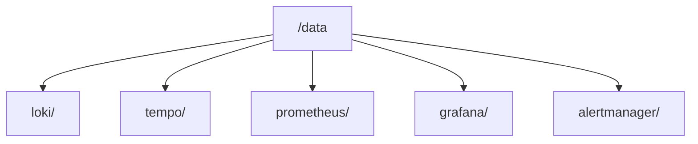
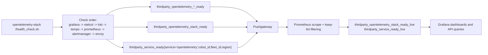

# OpenTelemetry Stack

Single image running Grafana, Prometheus, Pushgateway, Tempo, Loki, Pyroscope, Alertmanager, OTel Collector, and Envoy under supervisord — every signal the SDKs send (traces, metrics, logs, baggage-carrying requests, profiles) has somewhere to land.

## Services

| Service        | Internal Port | Description                    |
| -------------- | ------------- | ------------------------------ |
| Loki           | 3100/3101     | Log aggregation                |
| Tempo          | 3200/3201     | Distributed tracing            |
| Pyroscope      | 4040          | Continuous profiling           |
| Prometheus     | 9090          | Metrics                        |
| Pushgateway    | 9091          | Prometheus pushed metrics      |
| Alertmanager   | 9093          | Alert routing                  |
| OTel Collector | 4317/4318     | OTLP gRPC/HTTP ingestion       |
| Grafana        | 3000          | Dashboard UI                   |
| Envoy          | 6009         | Reverse proxy for OTLP ingress |

## Exposed Port (default)

Only one ingress port is exposed by default:

| Port  | Service                          |
| ----- | -------------------------------- |
| 6009 | Envoy OTLP gateway (gRPC + HTTP) |

Use this single port mapping for external ingestion. Internal services continue to communicate on their native container ports.

## Quick Start

```bash
docker run -d \
  -p 6009:6009 \
  -v opentelemetry-stack-data:/data \
  --name opentelemetry-stack \
  ghcr.io/the-protobuf-project/telemetry:latest
```

Images are published to GitHub Container Registry on each `v*` release:
`ghcr.io/the-protobuf-project/telemetry` (multi-arch: `linux/amd64`, `linux/arm64`).

## Configuration

All configs are embedded in the image under `/etc/opentelemetry-stack`.

At runtime, the stack uses:

- `STACK_CONFIG_DIR=/config` (default)
- if `/config` is not mounted, entrypoint auto-links `/config` to `/etc/opentelemetry-stack`
- optional override: mount your own folder and set `STACK_CONFIG_DIR`

### Environment Variables

| Variable                         | Default                | Description                              |
| -------------------------------- | ---------------------- | ---------------------------------------- |
| `ENABLE_ENVOY`                   | `true`                 | Enable Envoy reverse proxy               |
| `STACK_CONFIG_DIR`               | `/config`              | Stack config root directory              |
| `ENVOY_CONFIG`                   | `/config/envoy.yaml`   | Override Envoy config path               |
| `GRAFANA_DOMAIN`                 | `127.0.0.1`            | Public host/IP used by Grafana redirects |
| `HEALTH_METRICS_PUSHGATEWAY_URL` | —                      | Push health metrics to Pushgateway       |
| `HEALTH_METRICS_JOB`             | `opentelemetry-health` | Job label for pushed health metrics      |
| `HEALTH_METRICS_INSTANCE`        | container hostname     | Instance label for pushed health metrics |
| `HEALTH_METRICS_PUSH_STRICT`     | `false`                | Fail health check if push fails          |
| `ROBOT_ID`                       | `unknown`              | Metric label for robot identity          |
| `FLEET_ID`                       | `unknown`              | Metric label for fleet identity          |
| `REGION`                         | `unknown`              | Metric label for deployment region       |

### OTLP client endpoints (single external port)

- OTLP gRPC: `http://<host>:6009`
- OTLP HTTP: `http://<host>:6009/v1/traces` (or `/v1/metrics`, `/v1/logs`)

### Service endpoints via single external port

- Grafana UI: `http://<host>:6009/grafana/`. The **Distributed Journey**
  dashboard (`/grafana/d/telemetry-journey`) shows one request across
  services: its trace, every service's logs for it, a service map, and the
  metrics around it; `just crosslang` with
  `TELEMETRY_DEMO_OTLP=<host>:6009` fills it.
- Loki API: `http://<host>:6009/logs/...`
- Prometheus: `http://<host>:6009/metrics/...`
- Tempo HTTP API: `http://<host>:6009/traces/...`
- Pyroscope: profiles pushed to `http://<host>:6009/ingest` (point the SDKs'
  profiling server address at `http://<host>:6009`); UI and API at
  `http://<host>:6009/pyroscope/`
- Alertmanager UI/API: `http://<host>:6009/alertmanager/`
- Pushgateway: `http://<host>:6009/pushgateway/...`
- OTel Collector health: `http://<host>:6009/otelcol/`
- Envoy admin: `http://<host>:6009/envoy/` (powerful — trusted networks only)

Every internal service port is reachable through the single `6009` ingress; no
other port needs to be published.

### Curated readiness metrics

This stack keeps only curated `thirdparty_*` health metrics in Prometheus.

Common metric:

- `thirdparty_service_ready{service="<service-name>",robot_id="...",fleet_id="...",region="..."}`

Stack-specific health metrics include:

- `thirdparty_opentelemetry_stack_ready`
- `thirdparty_opentelemetry_grafana_ready`
- `thirdparty_opentelemetry_otelcol_ready`
- `thirdparty_opentelemetry_loki_ready`
- `thirdparty_opentelemetry_tempo_ready`
- `thirdparty_opentelemetry_prometheus_ready`
- `thirdparty_opentelemetry_alertmanager_ready`
- `thirdparty_opentelemetry_envoy_ready`

Freshness-adjusted recording rules expose `_live` variants (for example `thirdparty_service_ready_live`) that turn to `0` when Pushgateway series are stale.

## Sizing for 1M records/s

The image ships tuned for high volume: large collector batches, exporter
queues with retry, a `memory_limiter` that refuses data (retryably) before the
collector can be OOM-killed, and Loki / Tempo ingest limits raised from their
defaults (4 MB/s and 10,000 live traces), which refuse almost everything at
this rate. `just stack-bench` reproduces the measurements below.

### Measured: 8 CPUs, 6 GB, one container

`docker run --cpus 8 --memory 6g`. The Go SDK sends through Envoy (`:6009`) to the
collector, which writes to the backends, with
`ExportOptions{Lossless: true, Exporters: 4, BatchSize: 8192}`:

| Signal | 1M records | Collector accepted / refused | Reached the backend | Peak memory | Verdict |
| ------ | ---------- | ---------------------------- | ------------------- | ----------- | ------- |
| Logs   | 834k/s from the SDK | 1,000,000 / 0 | 987,568 in Loki when counters settled, rest draining | 1.7 GB | **Holds 1M/s on 4–5 cores** |
| Spans (1M *separate* traces) | 376k/s from the SDK, flushed in 0.4 s | all 1M taken into the collector's queue (none dropped by the SDK) | **376,832 in Tempo minutes later**, 0 discarded, 369,721 traces live in Tempo's memory (3.3 GB); the rest still queued in the collector. The CPUs stayed saturated, so Prometheus and the collector's own metrics stopped answering | 4.2 GB | **Does not fit in one 8-core box** |
| Metrics | 10.5M increments/s in-process | a few hundred points per export | all | — | **Trivial**: aggregated before export |

What the numbers say:

- **Logs at 1M/s fit in one container** with 8 cores and 6 GB. The collector
  used about 1.5 GB and 2–3 cores; Loki the rest.
- **Spans at 1M/s do not.** The binding cost is not the collector — it
  accepted everything — but Tempo: every root span is a trace Tempo holds in
  memory until it goes idle, and its metrics generator (span metrics, service
  graphs and the `local-blocks` processor behind TraceQL metrics) works through
  every one. A real workload is gentler (a trace is tens of spans, so 1M spans/s
  is ~50k traces/s), but plan for Tempo as its own process.
- **Metrics cost nothing at the backend** whatever the call rate: the SDK sums
  increments and exports one point per series per interval.

### Recommended allocation

| Rate (per signal) | Shape | CPU | Memory | Settings |
| ----------------- | ----- | --- | ------ | -------- |
| up to ~100k/s | this image, one container | 4 | 4 GB | defaults |
| logs 1M/s | this image | 8 | 6–8 GB | `-e OTELCOL_CPUS=3`; SDK `Exporters: 4`, `Lossless: true` |
| spans 1M/s | collector + Loki here, **Tempo on its own** (or `tempo-distributed`) | 8 here + 8–16 for Tempo | 6 GB here + 16 GB Tempo | drop `local-blocks` from `metrics_generator_processors` if TraceQL metrics are not needed |
| all signals 1M/s each | split per backend; scale the collector horizontally behind a load balancer (it is stateless) | 4 per collector replica (~500k records/s each) | 2 GB per replica | |

The collector takes a fixed share of the container (entrypoint.sh): half its
CPUs and a quarter of its memory by default, refusing data above 80% of that.
Override with `OTELCOL_CPUS`, `OTELCOL_MEMORY_MIB` or `OTELCOL_MEMORY_SHARE_PCT`.
Throughput knobs (`OTELCOL_BATCH_SIZE`, `OTELCOL_EXPORT_CONSUMERS`,
`OTELCOL_EXPORT_QUEUE`), Loki's (`LOKI_INGEST_MB`, `LOKI_STREAM_RATE`) and
Tempo's (`TEMPO_INGEST_BYTES`, `TEMPO_MAX_LIVE_TRACES`) are all environment
variables; see the comments at the top of each file in `config/`.

### Finding the bottleneck

The collector reports what it accepted, refused and failed per signal on
`:8888`, and Prometheus scrapes it (`job="otelcol"`):

```promql
sum(rate(otelcol_receiver_accepted_log_records_total[1m]))   # arriving
sum(rate(otelcol_receiver_refused_log_records_total[1m]))    # memory_limiter pushing back
sum(rate(otelcol_exporter_send_failed_log_records_total[1m])) # a backend rejecting
max(otelcol_exporter_queue_size) / max(otelcol_exporter_queue_capacity)  # how close to full
```

Refused climbing means the collector needs memory or cores; send-failed
climbing means the backend does (Loki 429s, Tempo `LIVE_TRACES_EXCEEDED`).
On the SDK side, `Telemetry.Stats()` and the error `Close` returns say what
never left the process.

## M3 as a metrics backend

[M3](https://m3db.io) can store the stack's metrics alongside (or instead of
querying) Prometheus. Set `M3_URL` to an m3coordinator and the collector
remote-writes every metric there too, including the span metrics it derives;
Grafana gets an **M3** datasource that queries it with PromQL. Logs and traces
stay in Loki and Tempo: M3 stores metrics only, and accepts Prometheus remote
write rather than OTLP, which is why the collector translates.

```bash
docker run -d -p 6009:6009 -e M3_URL=http://m3coordinator:7201 \
  ghcr.io/the-protobuf-project/telemetry:latest
```

Locally, `just m3-up` starts a single-node M3 (its namespace created) and
`just stack-m3` runs the stack beside it. Checked end to end: 100,000 counter
increments from the Go SDK read back as `loadgen_ops_total = 100000` from both
Prometheus and M3.

The M3 image is published for linux/amd64 only (it runs emulated on Apple
silicon), and its last release, v1.5.0, dates from 2022.

## Data Volume

All persistent data is stored under `/data`:



## Health Check

```bash
docker exec opentelemetry-stack /health_check.sh
```

Health checks execute in this order:

1. `grafana`
2. `otelcol`
3. `loki`
4. `tempo`
5. `prometheus`
6. `alertmanager`
7. `envoy`

## Build

```bash
just image local      # build locally for testing
just image amd64      # build + push linux/amd64 (likewise arm64)
just image manifest   # join the pushed architectures into one tag
just image-dev        # build telemetry-stack:dev for `just stack-bench`
```

## Prometheus Flow


