# Benchmarks

Every SDK writes **1,000,000** log records, spans and counter increments over OTLP/gRPC to one
in-process counting collector, so the numbers show what each SDK **delivered**, not only how
fast the calls returned. Regenerate with `just bench`; redraw this page from the saved
numbers (`docs/benchmarks.json`) with `just bench-render`.

Measured 2026-11-16 on Darwin arm64, 14 CPUs, Python 3.15.2.
Console log output is discarded (Go) or sent to /dev/null (Rust, Python), so the terminal is
not what is measured. **drop** is the default: a full export queue drops what does not fit,
counted and reported on close. **lossless** makes the writer wait for room instead.

## At a glance

### Logs

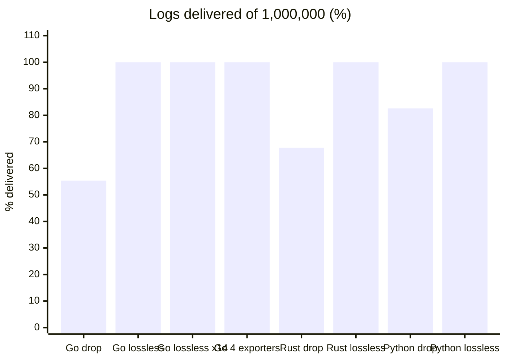

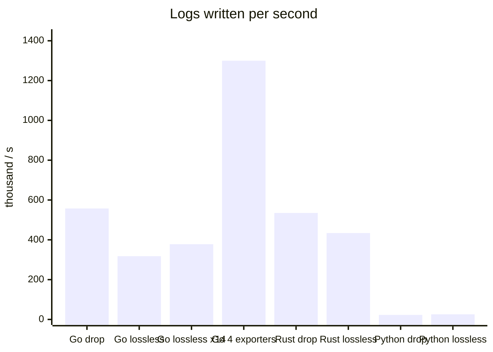

### Spans

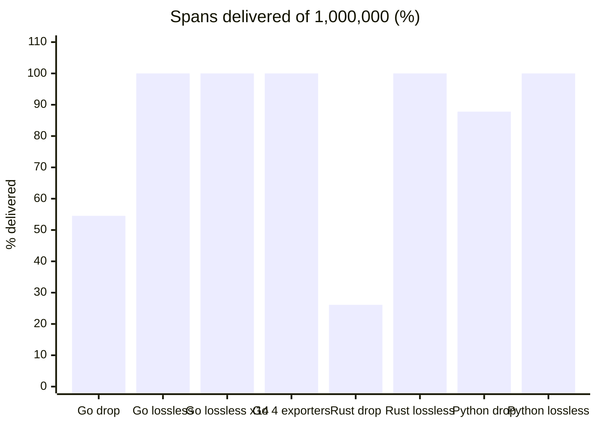

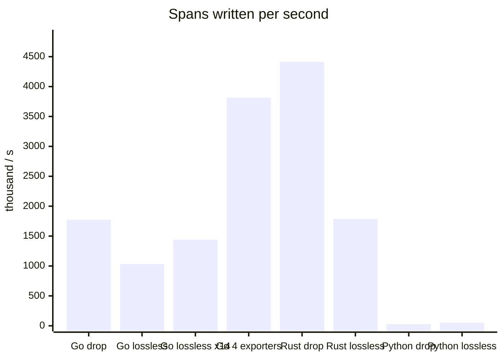

### Metrics

Every configuration delivers every increment: a counter exports its running total.

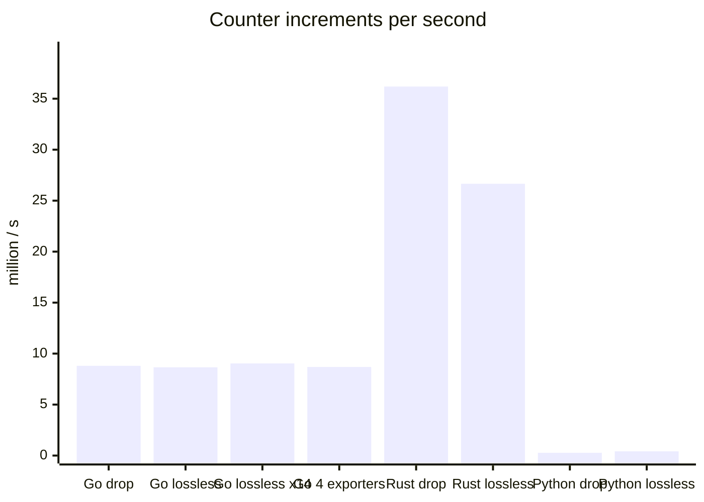

### Logs: speed against delivery

Right is faster (log scale, 1k/s to 10M/s); up is more of the records delivered.

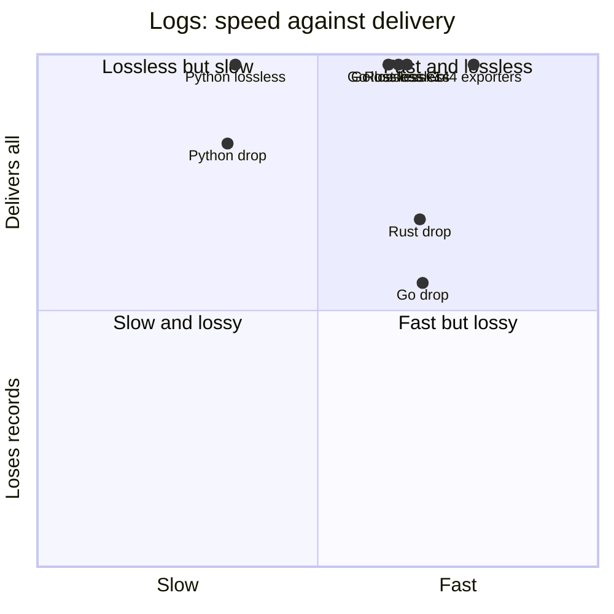

### Spans: speed against delivery

Right is faster (log scale, 1k/s to 10M/s); up is more of the records delivered.

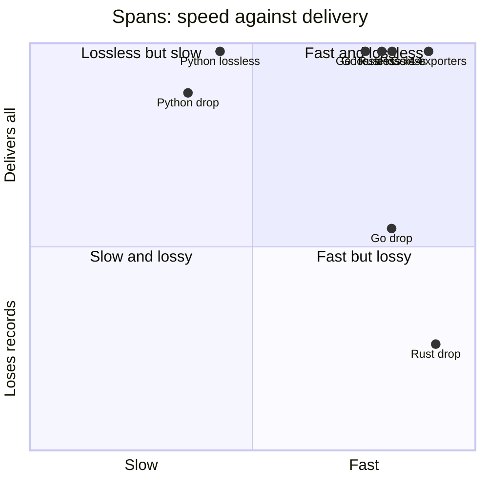

### Where the records went (default mode)

With the default drop-when-full queue, a burst faster than the collector loses what
does not fit; every SDK now counts it and reports it on close.

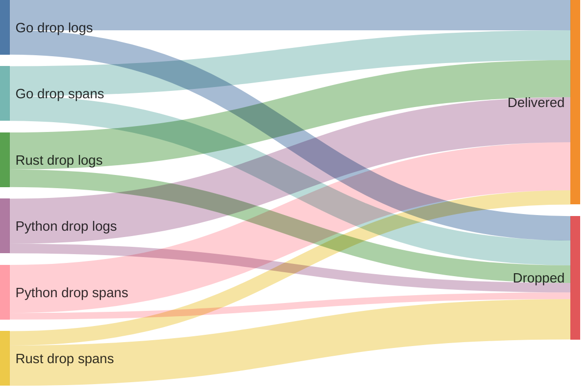

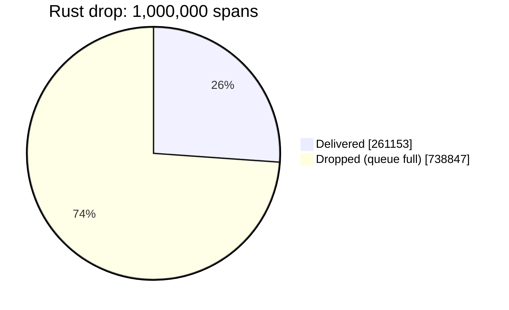

### Go: more exporters, more throughput

Measured 2026-11-16: 2,000,000 records per signal, lossless, 14 goroutines, batch 8192, to the in-process collector. Upper line spans, lower line logs (thousand / s).

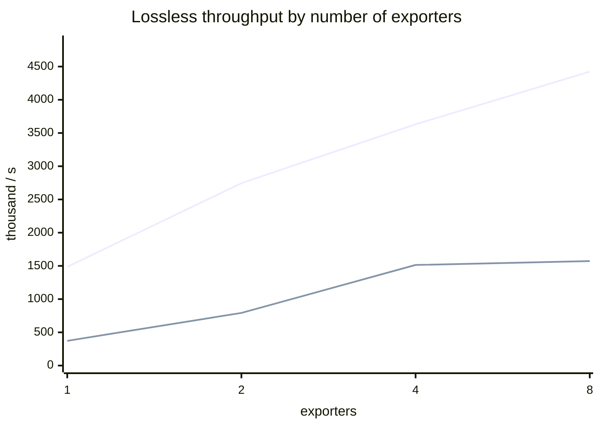

### MCAP recording

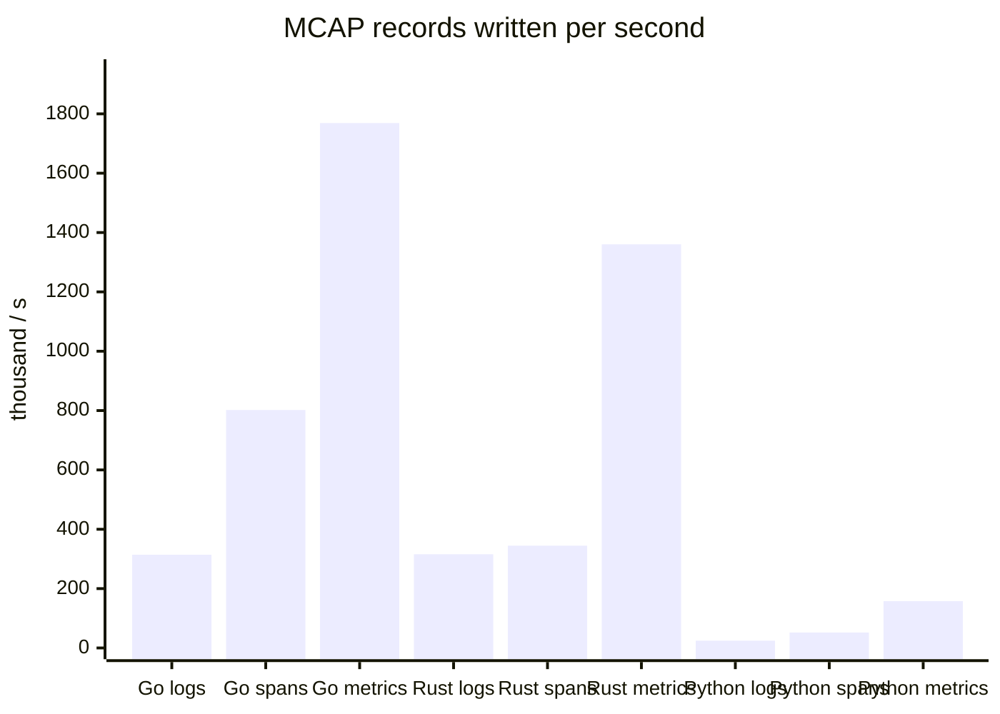

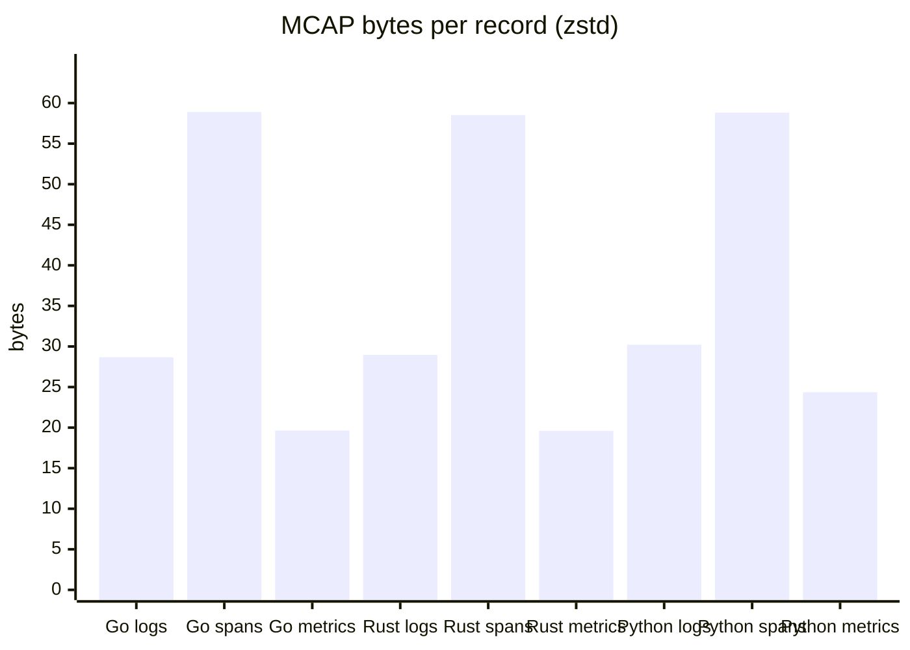

### Go: cost of one call

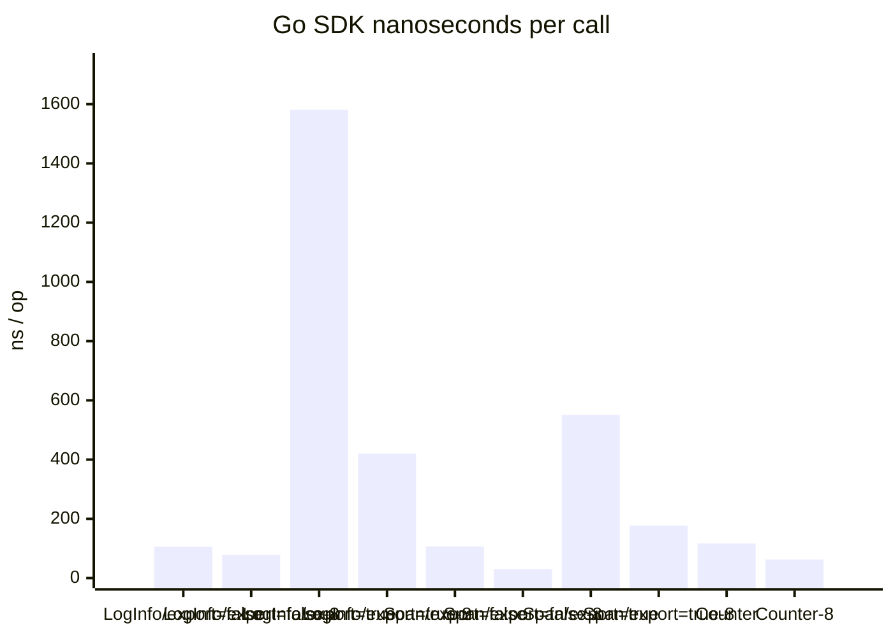

## OTLP export

| SDK | Mode | Signal | Delivered | Lost | Emit rate | Per call | Flush on close |
| --- | ---- | ------ | --------: | ---: | --------: | -------: | -------------: |
| Go | default (drop when full), 1 goroutine | logs | 553,698 | 44.6% | 557,529/s | 1,794 ns | 0.01 s |
| Go | default (drop when full), 1 goroutine | spans | 545,262 | 45.5% | 1,773,487/s | 564 ns | 0.00 s |
| Go | default (drop when full), 1 goroutine | metrics | 1,000,000 | 0.0% | 8,800,496/s | 114 ns | 0.00 s |
| Go | Lossless, 1 goroutine | logs | 1,000,000 | 0.0% | 317,920/s | 3,145 ns | 0.01 s |
| Go | Lossless, 1 goroutine | spans | 1,000,000 | 0.0% | 1,032,417/s | 969 ns | 0.00 s |
| Go | Lossless, 1 goroutine | metrics | 1,000,000 | 0.0% | 8,659,514/s | 115 ns | 0.00 s |
| Go | Lossless, 14 goroutines, batch 8192 | logs | 1,000,000 | 0.0% | 378,074/s | 2,645 ns | 0.21 s |
| Go | Lossless, 14 goroutines, batch 8192 | spans | 1,000,000 | 0.0% | 1,439,329/s | 695 ns | 0.05 s |
| Go | Lossless, 14 goroutines, batch 8192 | metrics | 1,000,000 | 0.0% | 9,036,352/s | 111 ns | 0.00 s |
| Go | Lossless, 14 goroutines, batch 8192, 4 exporters | logs | 1,000,000 | 0.0% | 1,299,999/s | 769 ns | 0.23 s |
| Go | Lossless, 14 goroutines, batch 8192, 4 exporters | spans | 1,000,000 | 0.0% | 3,813,331/s | 262 ns | 0.06 s |
| Go | Lossless, 14 goroutines, batch 8192, 4 exporters | metrics | 1,000,000 | 0.0% | 8,687,855/s | 115 ns | 0.00 s |
| Rust | default (drop when full) | logs | 678,083 | 32.2% | 534,920/s | 1,869 ns | 0.01 s |
| Rust | default (drop when full) | spans | 261,153 | 73.9% | 4,412,765/s | 227 ns | 0.00 s |
| Rust | default (drop when full) | metrics | 1,000,000 | 0.0% | 36,192,872/s | 28 ns | 0.00 s |
| Rust | Lossless | logs | 1,000,000 | 0.0% | 433,936/s | 2,304 ns | 0.14 s |
| Rust | Lossless | spans | 1,000,000 | 0.0% | 1,787,692/s | 559 ns | 0.04 s |
| Rust | Lossless | metrics | 1,000,000 | 0.0% | 26,655,264/s | 38 ns | 0.01 s |
| Python | default (drop when full) | logs | 825,907 | 17.4% | 22,682/s | 44,088 ns | 0.02 s |
| Python | default (drop when full) | spans | 878,084 | 12.2% | 26,420/s | 37,850 ns | 0.03 s |
| Python | default (drop when full) | metrics | 1,000,000 | 0.0% | 274,496/s | 3,643 ns | 0.01 s |
| Python | Lossless | logs | 1,000,000 | 0.0% | 25,859/s | 38,672 ns | 0.11 s |
| Python | Lossless | spans | 1,000,000 | 0.0% | 51,115/s | 19,564 ns | 0.06 s |
| Python | Lossless | metrics | 1,000,000 | 0.0% | 418,192/s | 2,391 ns | 0.00 s |

**Lost** is what never reached the collector. Metrics are aggregated in-process (a counter
exports its running total), so they cannot lose increments; logs and spans are exported one by
one through a bounded queue, and a queue that fills either drops (default) or makes the
program wait (lossless). Every SDK counts what it dropped and reports it on close.

## MCAP recording

The same 1,000,000 records per signal, recorded to an MCAP file for Foxglove with OTLP off,
then read back with the `mcap` library: **Recorded** is what the file holds.

| SDK | Signal | Recorded | Write rate | Per call | File size | Bytes / record |
| --- | ------ | -------: | ---------: | -------: | --------: | -------------: |
| Go | logs | 1,000,000 | 314,346/s | 3,181 ns | 27.3 MiB | 29 |
| Go | spans | 1,000,000 | 801,789/s | 1,247 ns | 56.2 MiB | 59 |
| Go | metrics | 1,000,000 | 1,768,889/s | 565 ns | 18.7 MiB | 20 |
| Rust | logs | 1,000,000 | 315,726/s | 3,167 ns | 27.6 MiB | 29 |
| Rust | spans | 1,000,000 | 344,658/s | 2,901 ns | 55.8 MiB | 59 |
| Rust | metrics | 1,000,000 | 1,360,350/s | 735 ns | 18.7 MiB | 20 |
| Python | logs | 1,000,000 | 24,478/s | 40,853 ns | 28.8 MiB | 30 |
| Python | spans | 1,000,000 | 52,085/s | 19,199 ns | 56.1 MiB | 59 |
| Python | metrics | 1,000,000 | 157,750/s | 6,339 ns | 23.2 MiB | 24 |

## Go: cost per call

`go test -bench . ./telemetry-go` — `export=false` is the SDK's own overhead with nothing
exported; `export=true` exports to an in-process collector. `-8` runs 8 goroutines in parallel.

| Benchmark | ns/op | B/op | allocs/op |
| --------- | ----: | ---: | --------: |
| `BenchmarkLogInfo/export=false` | 105.8 | 336 | 2 |
| `BenchmarkLogInfo/export=false-8` | 78.29 | 336 | 2 |
| `BenchmarkLogInfo/export=true` | 1581 | 1649 | 7 |
| `BenchmarkLogInfo/export=true-8` | 419.7 | 1847 | 10 |
| `BenchmarkSpan/export=false` | 107.0 | 240 | 5 |
| `BenchmarkSpan/export=false-8` | 30.42 | 240 | 5 |
| `BenchmarkSpan/export=true` | 551.2 | 1156 | 7 |
| `BenchmarkSpan/export=true-8` | 176.9 | 1148 | 7 |
| `BenchmarkCounter` | 116.7 | 43 | 2 |
| `BenchmarkCounter-8` | 62.57 | 42 | 2 |
