# Benchmarks

Every SDK writes **1,000,000** log records, spans and counter increments over OTLP/gRPC to one
in-process counting collector, so the numbers show what each SDK **delivered**, not only how
fast the calls returned. Regenerate with `just bench`; redraw this page from the saved
numbers (`docs/benchmark.json`) with `just bench-render`.

Measured 2026-11-16 on Darwin arm64, 14 CPUs, Python 3.14.10t.
Console log output is off in every load generator (Go formats it to io.Discard), so the terminal is
not what is measured. **drop** is the default: a full export queue drops what does not fit,
counted and reported on close. **lossless** makes the writer wait for room instead.

## Starting point: the official SDKs

Each language's upstream OpenTelemetry SDK alone, with its default batch processor and
OTLP exporter, given the same burst. The calls return fast, and most of the records never
arrive: the batch processor's 2048-slot queue fills and drops the rest without a word.

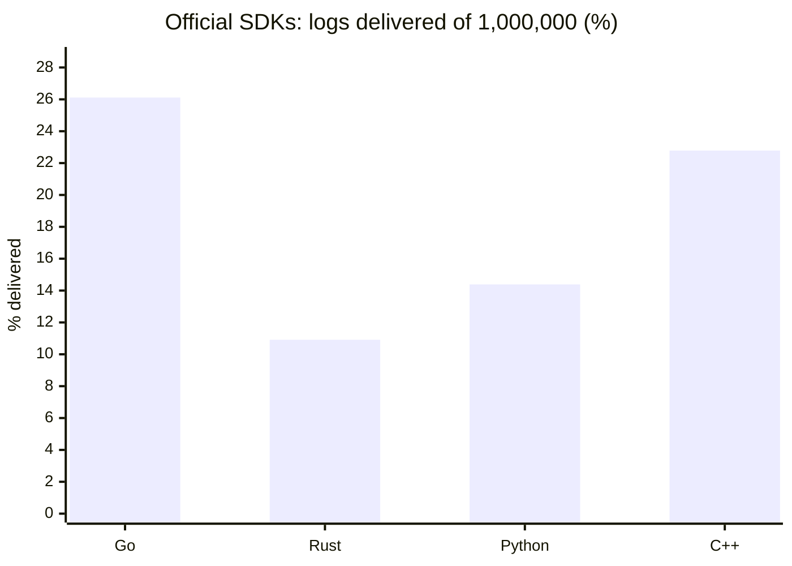

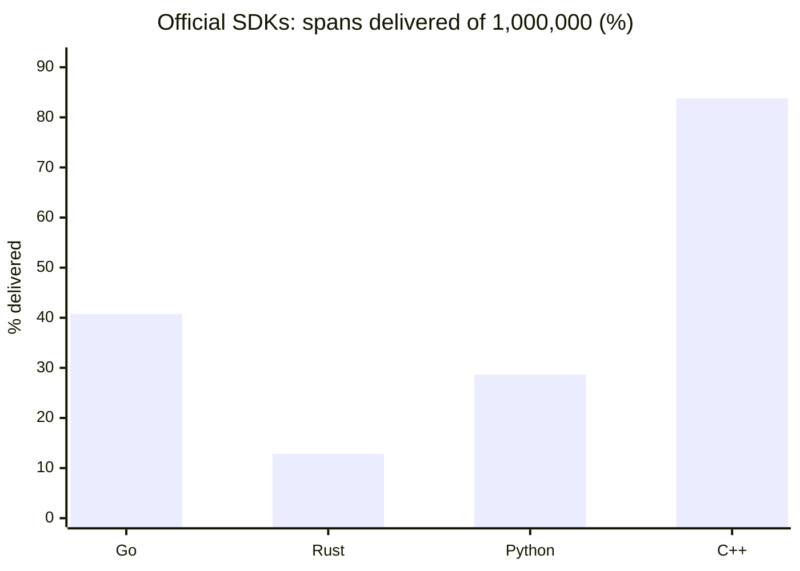

### Step by step, in Go

Each step changes one thing, starting from the official SDK. The last row delivers every
record at the official SDK's speed for logs and twice it for spans. The official run uses
one thread, so read this as what each SDK can be made to deliver, not a like-for-like race.

| Step | Logs delivered | Logs / s | Spans delivered | Spans / s |
| ---- | -------------: | -------: | --------------: | --------: |
| Official Go SDK alone | 261,120 | 1,689,596 | 407,326 | 1,964,476 |
| This SDK, default: drops counted and reported | 501,519 | 612,224 | 558,592 | 1,685,936 |
| Lossless: the writer waits for room | 1,000,000 | 313,354 | 1,000,000 | 1,031,928 |
| Lossless, one goroutine per CPU, batch 8192 | 1,000,000 | 386,110 | 1,000,000 | 1,442,794 |
| Lossless, plus 4 exporters in parallel | 1,000,000 | 1,238,486 | 1,000,000 | 4,001,832 |

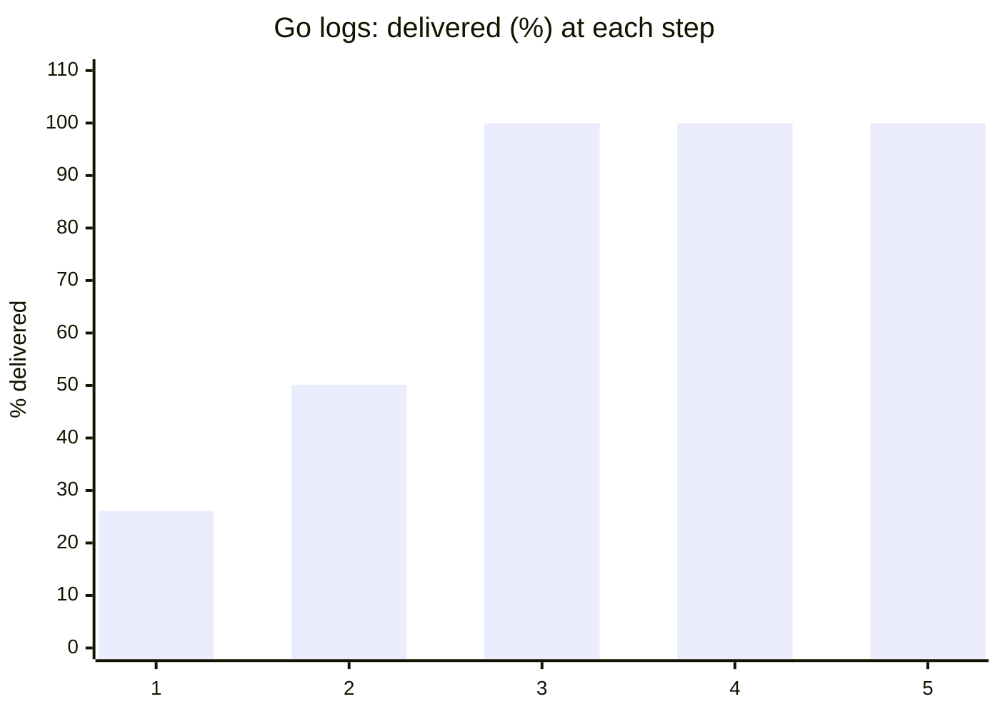

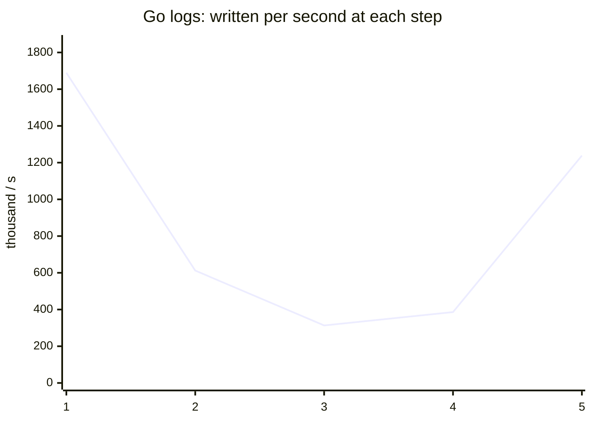


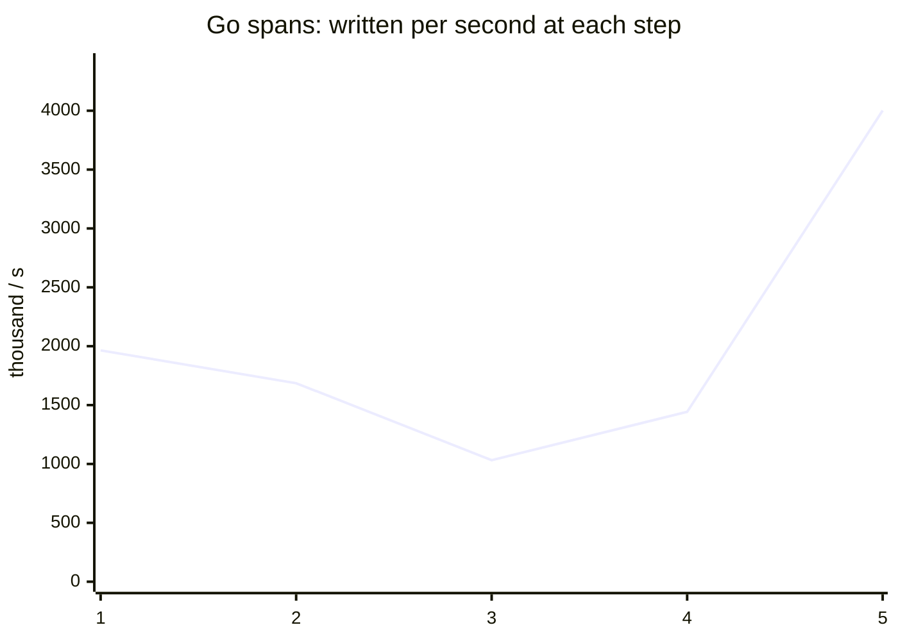

### Every language against its official SDK

This SDK's default and lossless modes beside the official SDK, one thread each. Above 1
means faster per call than the official SDK; the official SDK's speed is bought with the
records it drops.

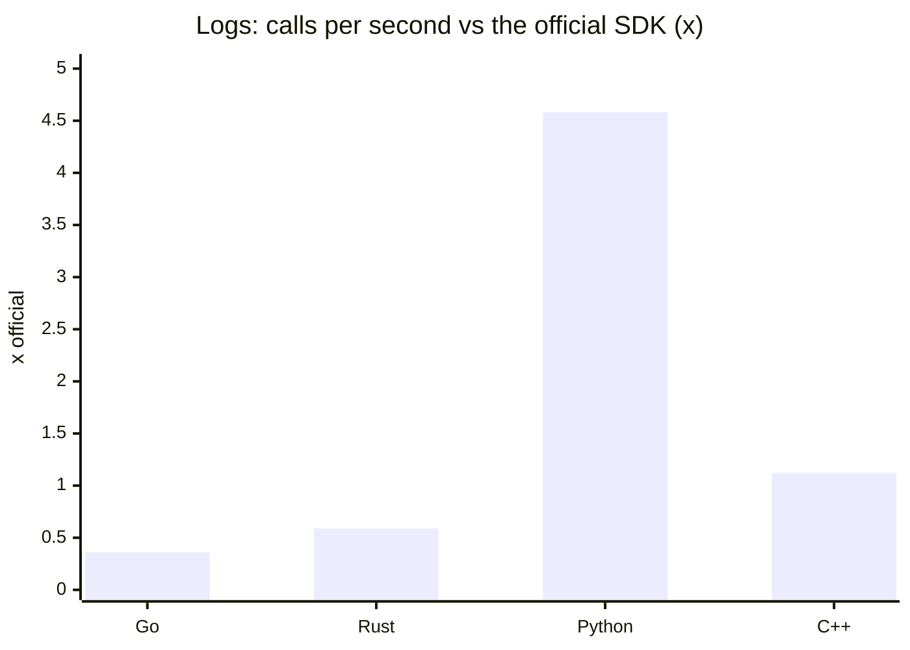

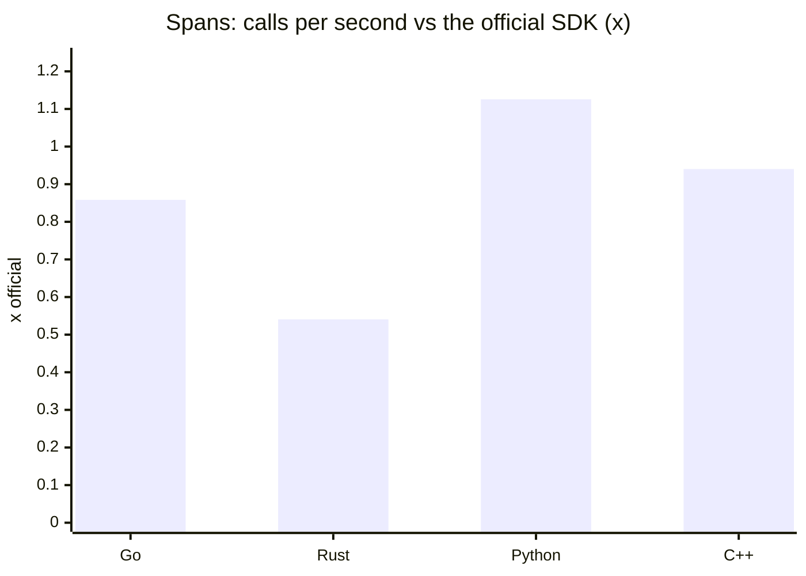

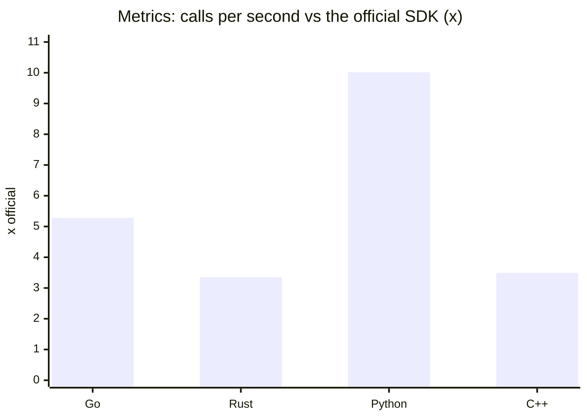

| Language | Signal | Official: delivered | Official: rate | This SDK, drop: delivered | rate | Lossless: delivered | rate |
| -------- | ------ | ------------------: | -------------: | ------------------------: | ---: | ------------------: | ---: |
| Go | logs | 261,120 | 1,689,596/s | 501,519 | 612,224/s | 1,000,000 | 313,354/s |
| Rust | logs | 109,113 | 6,965,310/s | 166,960 | 4,097,206/s | 1,000,000 | 862,015/s |
| Python | logs | 143,872 | 119,040/s | 351,348 | 545,589/s | 1,000,000 | 247,892/s |
| C++ | logs | 227,840 | 4,595,766/s | 294,912 | 5,156,051/s | — | — |
| Go | spans | 407,326 | 1,964,476/s | 558,592 | 1,685,936/s | 1,000,000 | 1,031,928/s |
| Rust | spans | 128,538 | 7,721,322/s | 289,763 | 4,174,593/s | 1,000,000 | 1,792,062/s |
| Python | spans | 286,720 | 87,761/s | 1,000,000 | 98,794/s | 1,000,000 | 93,309/s |
| C++ | spans | 837,768 | 1,982,145/s | 879,555 | 1,863,750/s | — | — |
| Go | metrics | 1,000,000 | 16,366,802/s | 1,000,000 | 86,437,894/s | 1,000,000 | 172,215,834/s |
| Rust | metrics | 1,000,000 | 199,279,287/s | 1,000,000 | 667,909,870/s | 1,000,000 | 1,301,376,726/s |
| Python | metrics | 1,000,000 | 592,438/s | 1,000,000 | 5,934,658/s | 1,000,000 | 5,971,326/s |
| C++ | metrics | 1,000,000 | 57,495,495/s | 1,000,000 | 200,626,959/s | — | — |

## Head to head: the official SDKs tuned

Defaults are not the official SDKs' best. Here each one is tuned through the standard
`OTEL_BLRP_*` and `OTEL_BSP_*` variables to a queue that holds the whole burst and batches
of 8192, so it drops nothing, and this SDK runs lossless with several exporters per signal
(Go 4, Rust 8, Python 4, C++ 8). Both get the same 1,000,000 records from the same number of threads.
**Goodput** is records that reached the collector per second, emitting and flushing included;
each figure is the median of several runs.

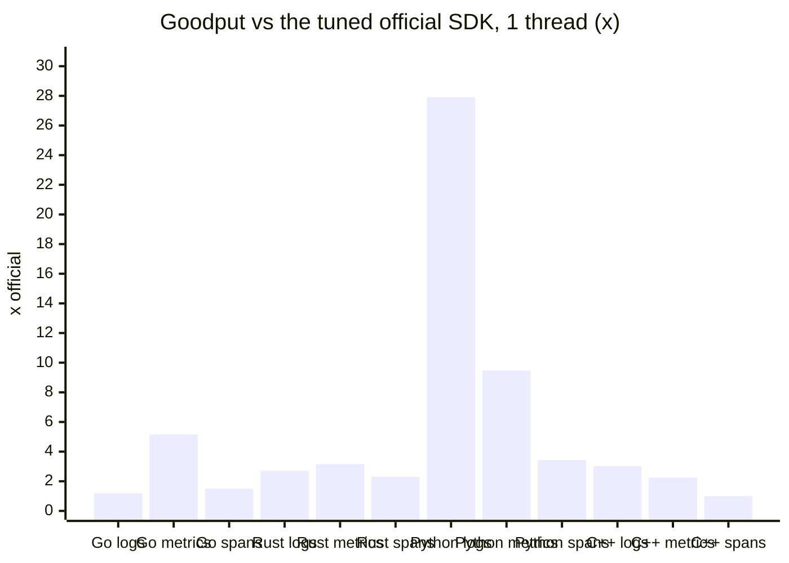

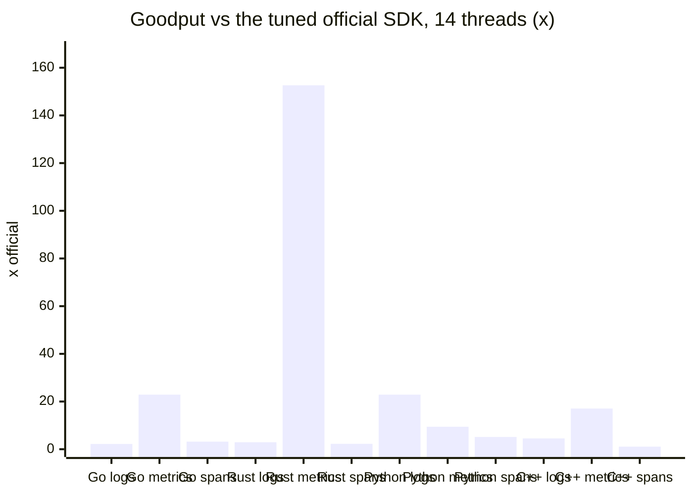

| Language | Signal | Threads | Official, tuned | This SDK | Delivered (both) | vs official |
| -------- | ------ | ------: | --------------: | -------: | ---------------: | ----------: |
| Go | logs | 1 | 560,897/s | 672,609/s | 1,000,000 / 1,000,000 | **1.20x** |
| Go | metrics | 1 | 18,584,338/s | 95,930,172/s | 1,000,000 / 1,000,000 | **5.16x** |
| Go | spans | 1 | 1,391,787/s | 2,098,840/s | 1,000,000 / 1,000,000 | **1.51x** |
| Rust | logs | 1 | 1,221,036/s | 3,306,549/s | 1,000,000 / 1,000,000 | **2.71x** |
| Rust | metrics | 1 | 100,837,801/s | 318,788,603/s | 1,000,000 / 1,000,000 | **3.16x** |
| Rust | spans | 1 | 1,784,565/s | 4,097,360/s | 1,000,000 / 1,000,000 | **2.30x** |
| Python | logs | 1 | 17,991/s | 502,303/s | 638,976 / 1,000,000 | **27.92x** |
| Python | metrics | 1 | 575,677/s | 5,447,979/s | 1,000,000 / 1,000,000 | **9.46x** |
| Python | spans | 1 | 25,363/s | 86,856/s | 1,000,000 / 1,000,000 | **3.42x** |
| C++ | logs | 1 | 1,457,395/s | 4,388,280/s | 1,000,000 / 1,000,000 | **3.01x** |
| C++ | metrics | 1 | 54,530,952/s | 122,530,880/s | 1,000,000 / 1,000,000 | **2.25x** |
| C++ | spans | 1 | 2,471,053/s | 2,472,956/s | 1,000,000 / 1,000,000 | **1.00x** |
| Go | logs | 14 | 565,843/s | 1,253,967/s | 1,000,000 / 1,000,000 | **2.22x** |
| Go | metrics | 14 | 10,960,896/s | 250,746,975/s | 1,000,000 / 1,000,000 | **22.88x** |
| Go | spans | 14 | 1,051,608/s | 3,341,158/s | 1,000,000 / 1,000,000 | **3.18x** |
| Rust | logs | 14 | 1,029,024/s | 3,008,829/s | 1,000,000 / 1,000,000 | **2.92x** |
| Rust | metrics | 14 | 3,561,468/s | 543,552,113/s | 1,000,000 / 1,000,000 | **152.62x** |
| Rust | spans | 14 | 1,555,172/s | 3,534,487/s | 1,000,000 / 1,000,000 | **2.27x** |
| Python | logs | 14 | 17,399/s | 398,195/s | 696,320 / 1,000,000 | **22.89x** |
| Python | metrics | 14 | 159,471/s | 1,502,625/s | 1,000,000 / 1,000,000 | **9.42x** |
| Python | spans | 14 | 24,305/s | 124,960/s | 917,504 / 1,000,000 | **5.14x** |
| C++ | logs | 14 | 1,041,319/s | 4,728,283/s | 1,000,000 / 1,000,000 | **4.54x** |
| C++ | metrics | 14 | 31,410,570/s | 535,415,314/s | 1,000,000 / 1,000,000 | **17.05x** |
| C++ | spans | 14 | 1,315,206/s | 1,415,776/s | 1,000,000 / 1,000,000 | **1.08x** |

Under 2x: C++ spans.
C++ spans are bounded inside opentelemetry-cpp's tracer: every span copies
reference-counted pointers that all threads share, in the official SDK and this one alike.

## At a glance

### Logs

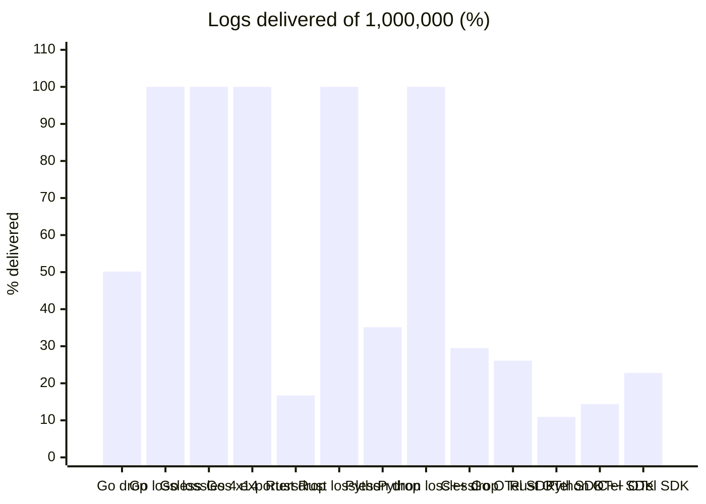

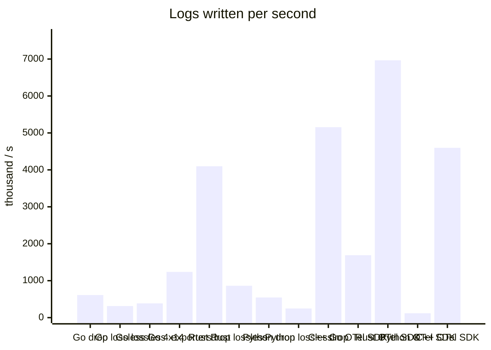

### Spans

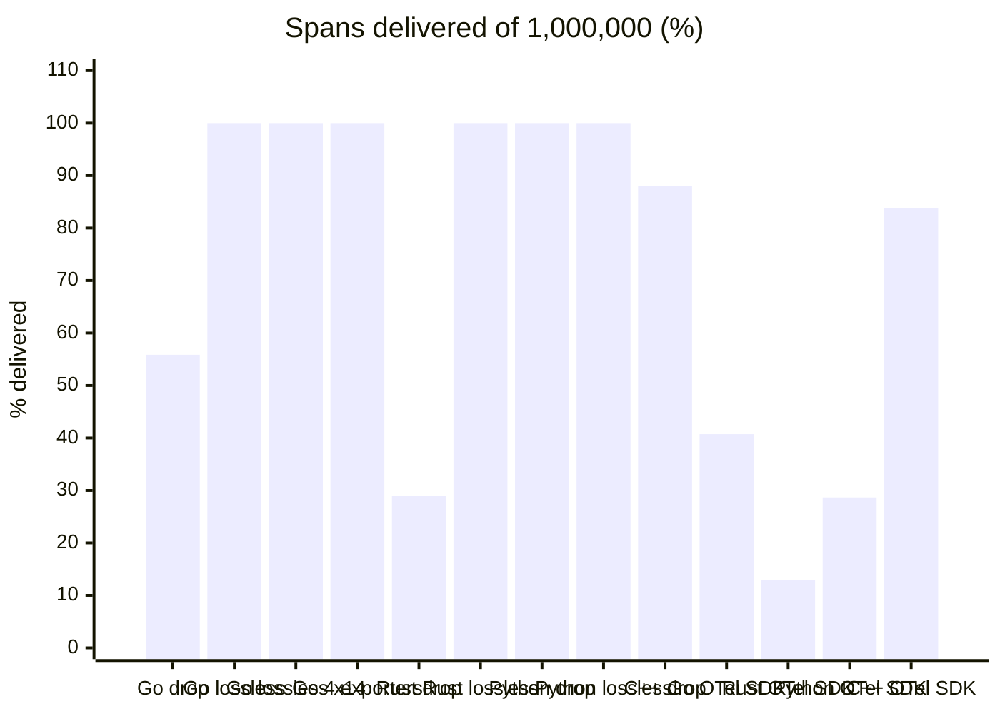

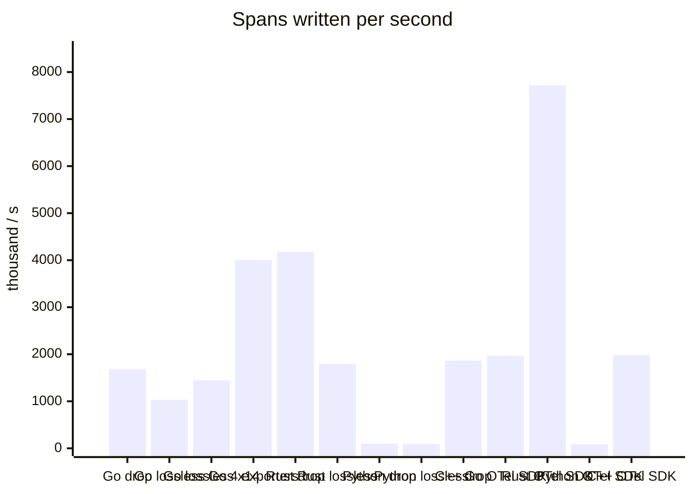

### Metrics

Every configuration delivers every increment: a counter exports its running total.

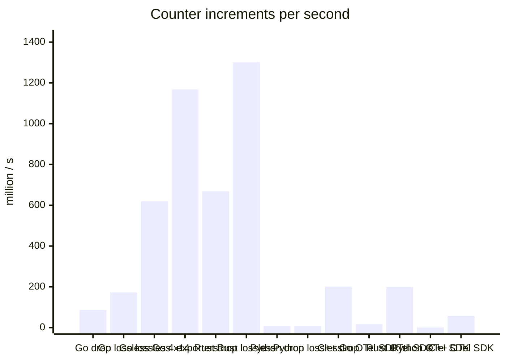

### Logs: speed against delivery

Right is faster (log scale, 1k/s to 10M/s); up is more of the records delivered.

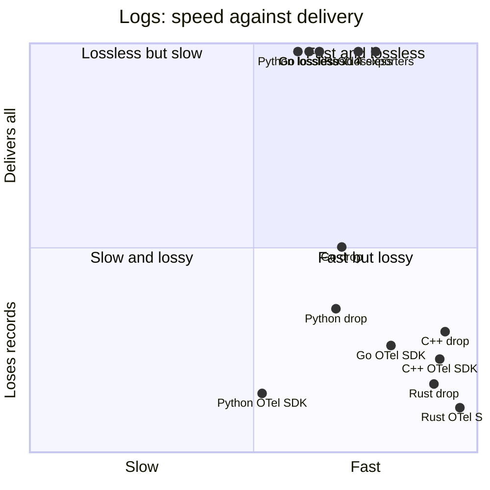

### Spans: speed against delivery

Right is faster (log scale, 1k/s to 10M/s); up is more of the records delivered.

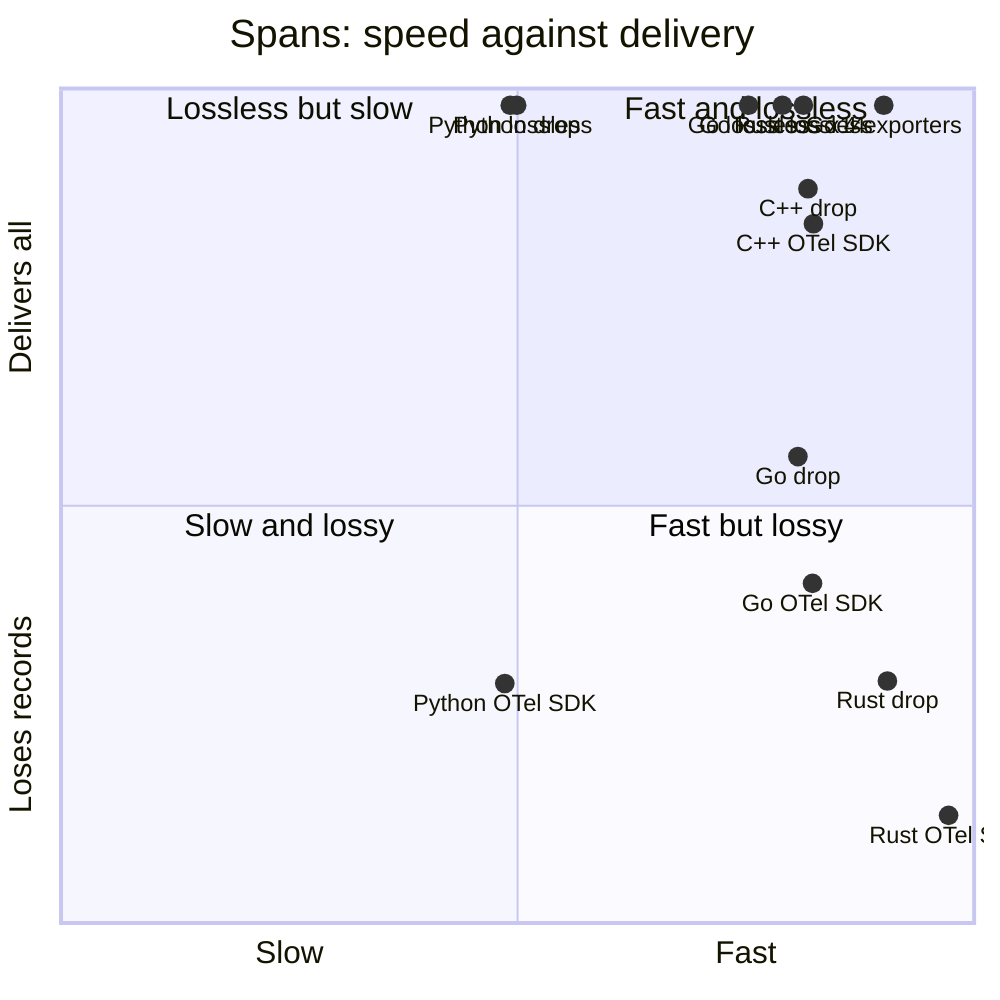

### Where the records went (default mode)

With the default drop-when-full queue, a burst faster than the collector loses what
does not fit; every SDK now counts it and reports it on close.

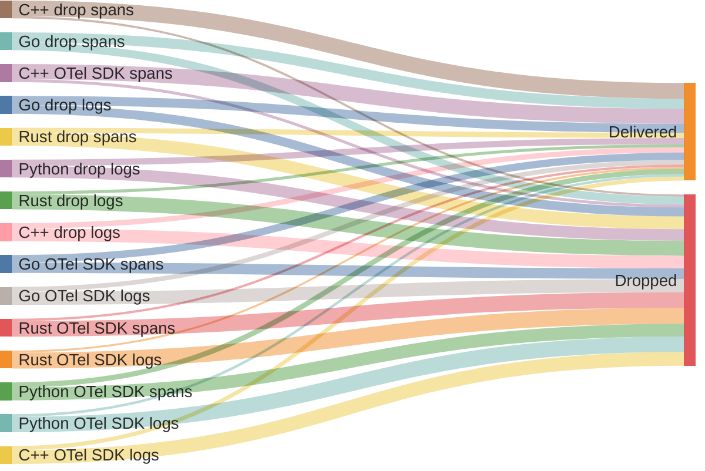


### Go: more exporters, more throughput

Measured 2026-11-16: 2,000,000 records per signal, lossless, 14 goroutines, batch 8192, to the in-process collector. Upper line spans, lower line logs (thousand / s).

```mermaid
xychart-beta
    title "Lossless throughput by number of exporters"
    x-axis "exporters" [1, 2, 4, 8]
    y-axis "thousand / s" 0 --> 4865
    line [1486, 2745, 3631, 4423]
    line [372, 792, 1514, 1572]
```

### MCAP recording

```mermaid
xychart-beta
    title "MCAP records written per second"
    x-axis ["Go logs", "Go spans", "Go metrics", "Rust logs", "Rust spans", "Rust metrics", "Python logs", "Python spans", "Python metrics"]
    y-axis "thousand / s" 0 --> 2552.66
    bar [361.554, 819.139, 2320.6, 855.335, 620.727, 1884.76, 161.783, 55.1458, 283.232]
```

```mermaid
xychart-beta
    title "MCAP bytes per record (zstd)"
    x-axis ["Go logs", "Go spans", "Go metrics", "Rust logs", "Rust spans", "Rust metrics", "Python logs", "Python spans", "Python metrics"]
    y-axis "bytes" 0 --> 64.7223
    bar [28.6033, 58.8385, 18.8272, 28.6493, 58.3609, 18.962, 28.9075, 58.8152, 23.7019]
```

### Go: cost of one call

```mermaid
xychart-beta
    title "Go SDK nanoseconds per call"
    x-axis ["LogInfo/export=false", "LogInfo/export=false-8", "LogInfo/export=true", "LogInfo/export=true-8", "Span/export=false", "Span/export=false-8", "Span/export=true", "Span/export=true-8", "Counter", "Counter-8", "CounterHandle", "CounterHandle-8"]
    y-axis "ns / op" 0 --> 1519.1
    bar [99.77, 76.87, 1381, 642.5, 104.4, 30.38, 545, 233.1, 15.11, 3.624, 3.795, 0.9569]
```

## OTLP export

| SDK | Mode | Signal | Delivered | Lost | Emit rate | Per call | Flush on close |
| --- | ---- | ------ | --------: | ---: | --------: | -------: | -------------: |
| Go | default (drop when full), 1 goroutine | logs | 501,519 | 49.8% | 612,224/s | 1,633 ns | 0.01 s |
| Go | default (drop when full), 1 goroutine | spans | 558,592 | 44.1% | 1,685,936/s | 593 ns | 0.00 s |
| Go | default (drop when full), 1 goroutine | metrics | 1,000,000 | 0.0% | 86,437,894/s | 12 ns | 0.00 s |
| Go | Lossless, 1 goroutine | logs | 1,000,000 | 0.0% | 313,354/s | 3,191 ns | 0.01 s |
| Go | Lossless, 1 goroutine | spans | 1,000,000 | 0.0% | 1,031,928/s | 969 ns | 0.00 s |
| Go | Lossless, 1 goroutine | metrics | 1,000,000 | 0.0% | 172,215,834/s | 6 ns | 0.00 s |
| Go | Lossless, 14 goroutines, batch 8192 | logs | 1,000,000 | 0.0% | 386,110/s | 2,590 ns | 0.15 s |
| Go | Lossless, 14 goroutines, batch 8192 | spans | 1,000,000 | 0.0% | 1,442,794/s | 693 ns | 0.04 s |
| Go | Lossless, 14 goroutines, batch 8192 | metrics | 1,000,000 | 0.0% | 619,690,799/s | 2 ns | 0.00 s |
| Go | Lossless, 14 goroutines, batch 8192, 4 exporters | logs | 1,000,000 | 0.0% | 1,238,486/s | 807 ns | 0.03 s |
| Go | Lossless, 14 goroutines, batch 8192, 4 exporters | spans | 1,000,000 | 0.0% | 4,001,832/s | 250 ns | 0.04 s |
| Go | Lossless, 14 goroutines, batch 8192, 4 exporters | metrics | 1,000,000 | 0.0% | 1,168,337,584/s | 1 ns | 0.00 s |
| Rust | default (drop when full) | logs | 166,960 | 83.3% | 4,097,206/s | 244 ns | 0.00 s |
| Rust | default (drop when full) | spans | 289,763 | 71.0% | 4,174,593/s | 240 ns | 0.00 s |
| Rust | default (drop when full) | metrics | 1,000,000 | 0.0% | 667,909,870/s | 1 ns | 0.00 s |
| Rust | Lossless | logs | 1,000,000 | 0.0% | 862,015/s | 1,160 ns | 0.07 s |
| Rust | Lossless | spans | 1,000,000 | 0.0% | 1,792,062/s | 558 ns | 0.03 s |
| Rust | Lossless | metrics | 1,000,000 | 0.0% | 1,301,376,726/s | 1 ns | 0.00 s |
| Python | default (drop when full) | logs | 351,348 | 64.9% | 545,589/s | 1,833 ns | 0.01 s |
| Python | default (drop when full) | spans | 1,000,000 | 0.0% | 98,794/s | 10,122 ns | 0.00 s |
| Python | default (drop when full) | metrics | 1,000,000 | 0.0% | 5,934,658/s | 169 ns | 0.01 s |
| Python | Lossless | logs | 1,000,000 | 0.0% | 247,892/s | 4,034 ns | 0.29 s |
| Python | Lossless | spans | 1,000,000 | 0.0% | 93,309/s | 10,717 ns | 0.02 s |
| Python | Lossless | metrics | 1,000,000 | 0.0% | 5,971,326/s | 167 ns | 0.01 s |
| C++ | default (drop when full) | logs | 294,912 | 70.5% | 5,156,051/s | 194 ns | 0.00 s |
| C++ | default (drop when full) | spans | 879,555 | 12.0% | 1,863,750/s | 537 ns | 0.00 s |
| C++ | default (drop when full) | metrics | 1,000,000 | 0.0% | 200,626,959/s | 5 ns | 0.00 s |
| Go | official OpenTelemetry SDK alone (default batch processor) | logs | 261,120 | 73.9% | 1,689,596/s | 592 ns | 0.00 s |
| Go | official OpenTelemetry SDK alone (default batch processor) | spans | 407,326 | 59.3% | 1,964,476/s | 509 ns | 0.00 s |
| Go | official OpenTelemetry SDK alone (default batch processor) | metrics | 1,000,000 | 0.0% | 16,366,802/s | 61 ns | 0.00 s |
| Rust | official OpenTelemetry SDK alone (default batch processor) | logs | 109,113 | 89.1% | 6,965,310/s | 144 ns | 0.00 s |
| Rust | official OpenTelemetry SDK alone (default batch processor) | spans | 128,538 | 87.1% | 7,721,322/s | 130 ns | 0.00 s |
| Rust | official OpenTelemetry SDK alone (default batch processor) | metrics | 1,000,000 | 0.0% | 199,279,287/s | 5 ns | 0.00 s |
| Python | official OpenTelemetry SDK alone (default batch processor) | logs | 143,872 | 85.6% | 119,040/s | 8,401 ns | 0.12 s |
| Python | official OpenTelemetry SDK alone (default batch processor) | spans | 286,720 | 71.3% | 87,761/s | 11,395 ns | 0.09 s |
| Python | official OpenTelemetry SDK alone (default batch processor) | metrics | 1,000,000 | 0.0% | 592,438/s | 1,688 ns | 0.01 s |
| C++ | official OpenTelemetry SDK alone (default batch processor) | logs | 227,840 | 77.2% | 4,595,766/s | 218 ns | 0.00 s |
| C++ | official OpenTelemetry SDK alone (default batch processor) | spans | 837,768 | 16.2% | 1,982,145/s | 505 ns | 0.00 s |
| C++ | official OpenTelemetry SDK alone (default batch processor) | metrics | 1,000,000 | 0.0% | 57,495,495/s | 17 ns | 0.00 s |

**Lost** is what never reached the collector. Metrics are aggregated in-process (a counter
exports its running total), so they cannot lose increments; logs and spans are exported one by
one through a bounded queue, and a queue that fills either drops (default) or makes the
program wait (lossless). Every SDK counts what it dropped and reports it on close.

## MCAP recording

The same 1,000,000 records per signal, recorded to an MCAP file for Foxglove with OTLP off,
then read back with the `mcap` library: **Recorded** is what the file holds.

| SDK | Signal | Recorded | Write rate | Per call | File size | Bytes / record |
| --- | ------ | -------: | ---------: | -------: | --------: | -------------: |
| Go | logs | 1,000,000 | 361,554/s | 2,766 ns | 27.3 MiB | 29 |
| Go | spans | 1,000,000 | 819,139/s | 1,221 ns | 56.1 MiB | 59 |
| Go | metrics | 1,000,000 | 2,320,604/s | 431 ns | 18.0 MiB | 19 |
| Rust | logs | 1,000,000 | 855,335/s | 1,169 ns | 27.3 MiB | 29 |
| Rust | spans | 1,000,000 | 620,727/s | 1,611 ns | 55.7 MiB | 58 |
| Rust | metrics | 1,000,000 | 1,884,758/s | 531 ns | 18.1 MiB | 19 |
| Python | logs | 1,000,000 | 161,783/s | 6,181 ns | 27.6 MiB | 29 |
| Python | spans | 1,000,000 | 55,146/s | 18,134 ns | 56.1 MiB | 59 |
| Python | metrics | 1,000,000 | 283,232/s | 3,531 ns | 22.6 MiB | 24 |

## Go: cost per call

`go test -bench . ./telemetry-go` — `export=false` is the SDK's own overhead with nothing
exported; `export=true` exports to an in-process collector. `-8` runs 8 goroutines in parallel.

| Benchmark | ns/op | B/op | allocs/op |
| --------- | ----: | ---: | --------: |
| `BenchmarkLogInfo/export=false` | 99.77 | 336 | 2 |
| `BenchmarkLogInfo/export=false-8` | 76.87 | 336 | 2 |
| `BenchmarkLogInfo/export=true` | 1381 | 1380 | 5 |
| `BenchmarkLogInfo/export=true-8` | 642.5 | 1811 | 13 |
| `BenchmarkSpan/export=false` | 104.4 | 240 | 5 |
| `BenchmarkSpan/export=false-8` | 30.38 | 240 | 5 |
| `BenchmarkSpan/export=true` | 545.0 | 1139 | 7 |
| `BenchmarkSpan/export=true-8` | 233.1 | 1270 | 8 |
| `BenchmarkCounter` | 15.11 | 0 | 0 |
| `BenchmarkCounter-8` | 3.624 | 0 | 0 |
| `BenchmarkCounterHandle` | 3.795 | 0 | 0 |
| `BenchmarkCounterHandle-8` | 0.9569 | 0 | 0 |
