# Benchmarks

Every SDK writes **1,000,000** log records, spans and counter increments over OTLP/gRPC to one
in-process counting collector, so the numbers show what each SDK **delivered**, not only how
fast the calls returned. Regenerate with `just bench`; redraw this page from the saved
numbers (`docs/benchmark.json`) with `just bench-render`.

Measured 2026-11-22 on Darwin arm64, 14 CPUs, Python 3.14.10t.
Console log output is off in every load generator (Go formats it to io.Discard), so the terminal is
not what is measured. **drop** is the default: a full export queue drops what does not fit,
counted and reported on close. **lossless** makes the writer wait for room instead.

## Starting point: the official SDKs

Each language's upstream OpenTelemetry SDK alone, with its default batch processor and
OTLP exporter, given the same burst. The calls return fast, and most of the records never
arrive: the batch processor's 2048-slot queue fills and drops the rest without a word.

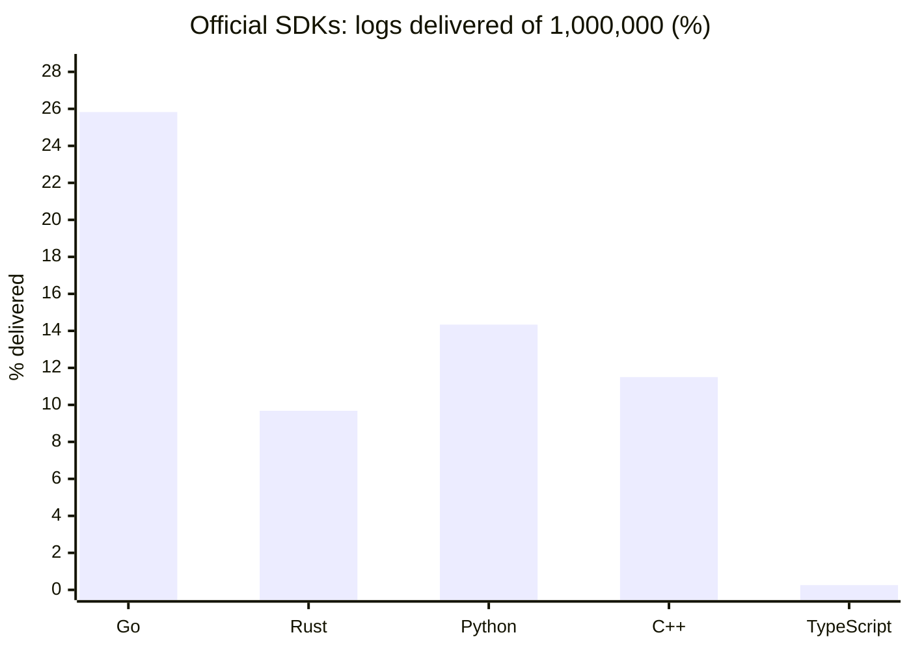

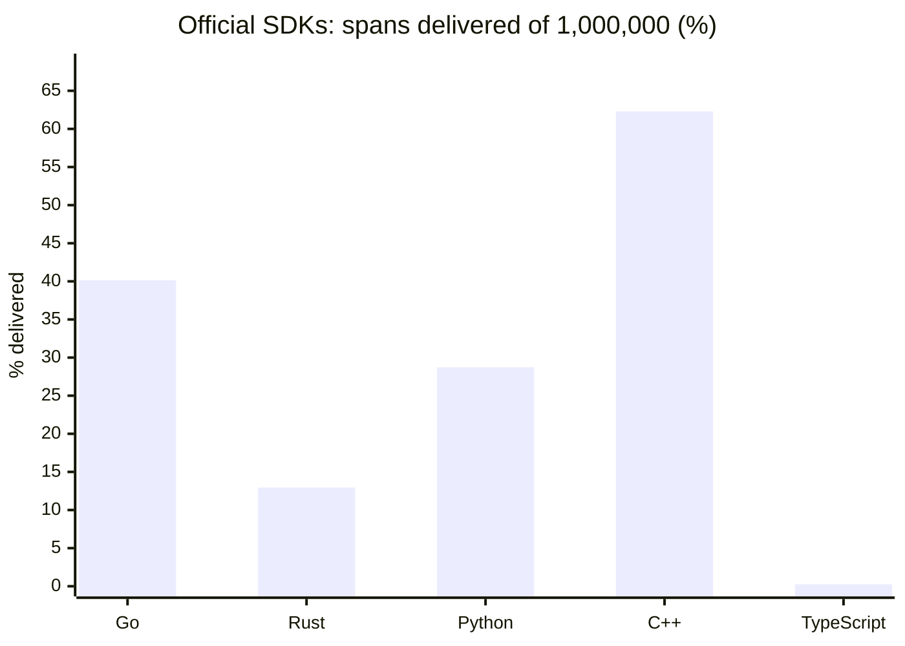

### Step by step, in Go

Each step changes one thing, starting from the official SDK. The last row delivers every
record at the official SDK's speed for logs and twice it for spans. The official run uses
one thread, so read this as what each SDK can be made to deliver, not a like-for-like race.

| Step | Logs delivered | Logs / s | Spans delivered | Spans / s |
| ---- | -------------: | -------: | --------------: | --------: |
| Official Go SDK alone | 258,286 | 1,694,065 | 401,408 | 2,182,265 |
| This SDK, default: drops counted and reported | 486,812 | 623,101 | 534,016 | 1,817,657 |
| Lossless: the writer waits for room | 1,000,000 | 312,634 | 1,000,000 | 461,101 |
| Lossless, one goroutine per CPU, batch 8192 | 1,000,000 | 236,491 | 1,000,000 | 767,934 |
| Lossless, plus 4 exporters in parallel | 1,000,000 | 649,714 | 1,000,000 | 1,315,179 |

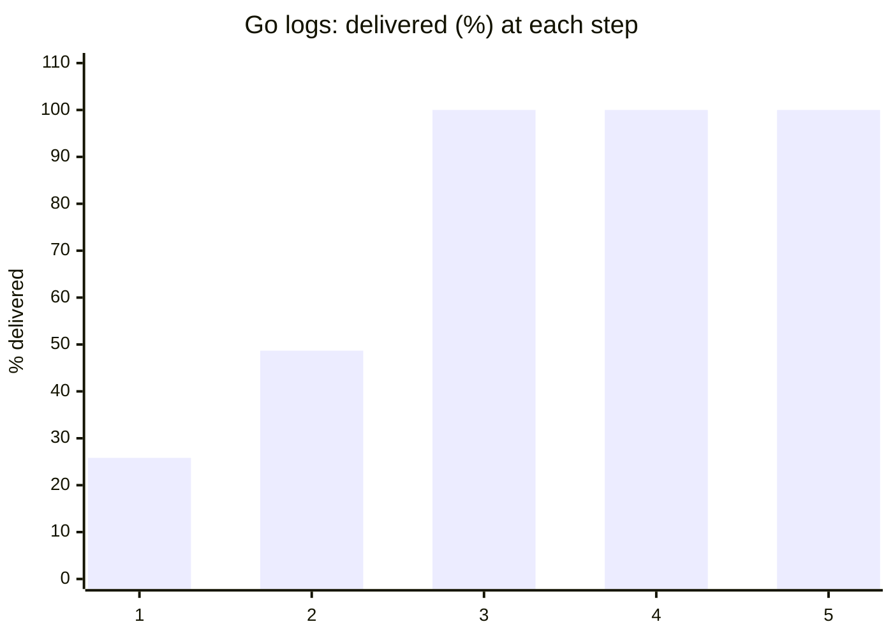

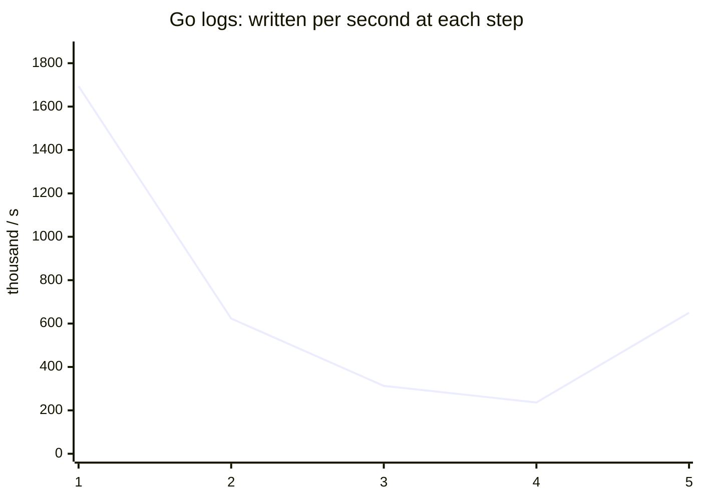

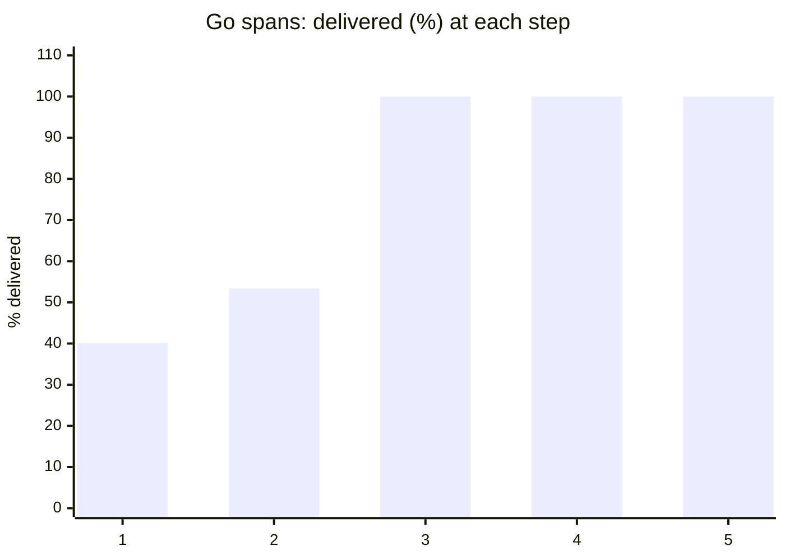

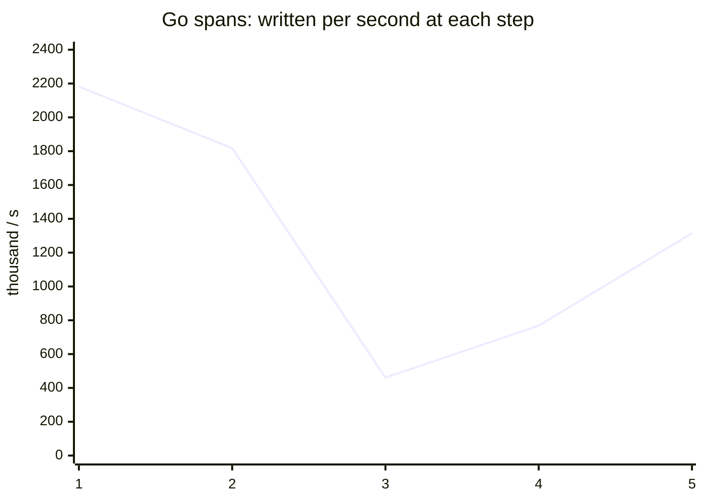

### Every language against its official SDK

This SDK's default and lossless modes beside the official SDK, one thread each. Above 1
means faster per call than the official SDK; the official SDK's speed is bought with the
records it drops.

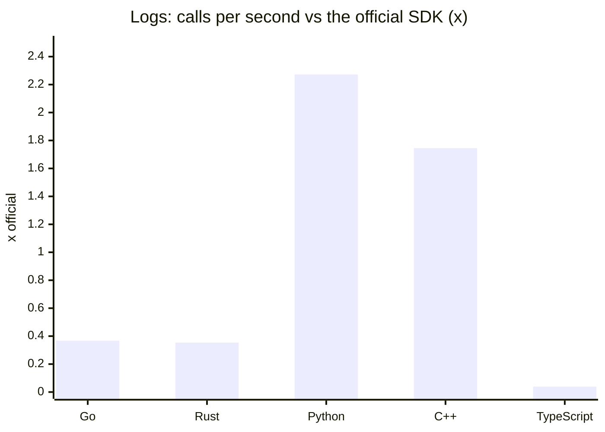

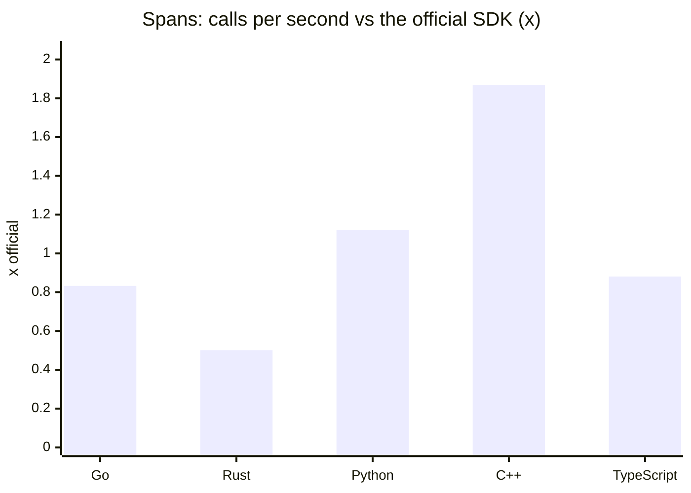

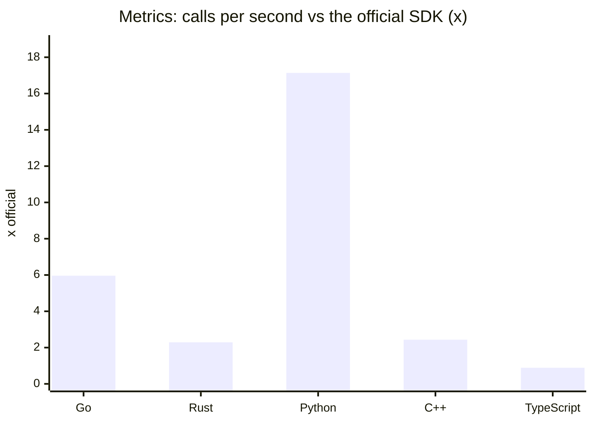

| Language | Signal | Official: delivered | Official: rate | This SDK, drop: delivered | rate | Lossless: delivered | rate |
| -------- | ------ | ------------------: | -------------: | ------------------------: | ---: | ------------------: | ---: |
| Go | logs | 258,286 | 1,694,065/s | 486,812 | 623,101/s | 1,000,000 | 312,634/s |
| Rust | logs | 96,809 | 8,495,873/s | 65,528 | 3,008,263/s | 1,000,000 | 689,899/s |
| Python | logs | 143,383 | 116,530/s | 192,153 | 264,790/s | 1,000,000 | 238,830/s |
| C++ | logs | 115,003 | 3,193,300/s | 332,800 | 5,573,032/s | — | — |
| TypeScript | logs | 2,560 | 3,858,102/s | 2,560 | 150,115/s | 1,000,000 | 141,079/s |
| Go | spans | 401,408 | 2,182,265/s | 534,016 | 1,817,657/s | 1,000,000 | 461,101/s |
| Rust | spans | 129,558 | 9,235,110/s | 69,651 | 4,627,644/s | 1,000,000 | 845,932/s |
| Python | spans | 287,232 | 84,713/s | 1,000,000 | 94,991/s | 1,000,000 | 90,217/s |
| C++ | spans | 623,026 | 1,040,891/s | 897,247 | 1,944,867/s | — | — |
| TypeScript | spans | 2,560 | 1,975,434/s | 2,560 | 1,740,699/s | 1,000,000 | 603,650/s |
| Go | metrics | 1,000,000 | 24,213,710/s | 1,000,000 | 144,366,974/s | 1,000,000 | 222,343,721/s |
| Rust | metrics | 1,000,000 | 196,397,751/s | 1,000,000 | 449,834,056/s | 1,000,000 | 391,051,338/s |
| Python | metrics | 1,000,000 | 347,474/s | 1,000,000 | 5,954,602/s | 1,000,000 | 5,905,781/s |
| C++ | metrics | 1,000,000 | 74,466,402/s | 1,000,000 | 181,186,762/s | — | — |
| TypeScript | metrics | 1,000,000 | 31,603,148/s | 1,000,000 | 27,995,423/s | 1,000,000 | 27,352,204/s |

## Head to head: the official SDKs tuned

Defaults are not the official SDKs' best. Here each one is tuned through the standard
`OTEL_BLRP_*` and `OTEL_BSP_*` variables to a queue that holds the whole burst and batches
of 8192, so it drops nothing, and this SDK runs lossless with several exporters per signal
(Go 4, Rust 8, Python 4, C++ 8). Both get the same 1,000,000 records from the same number of threads.
**Goodput** is records that reached the collector per second, emitting and flushing included;
each figure is the median of several runs.

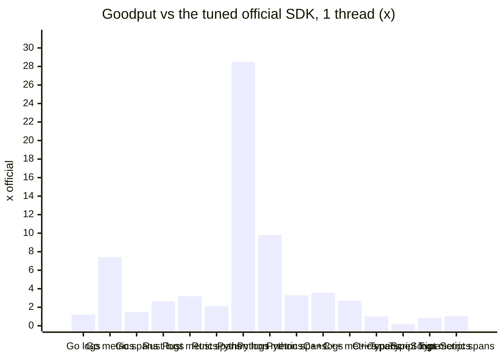

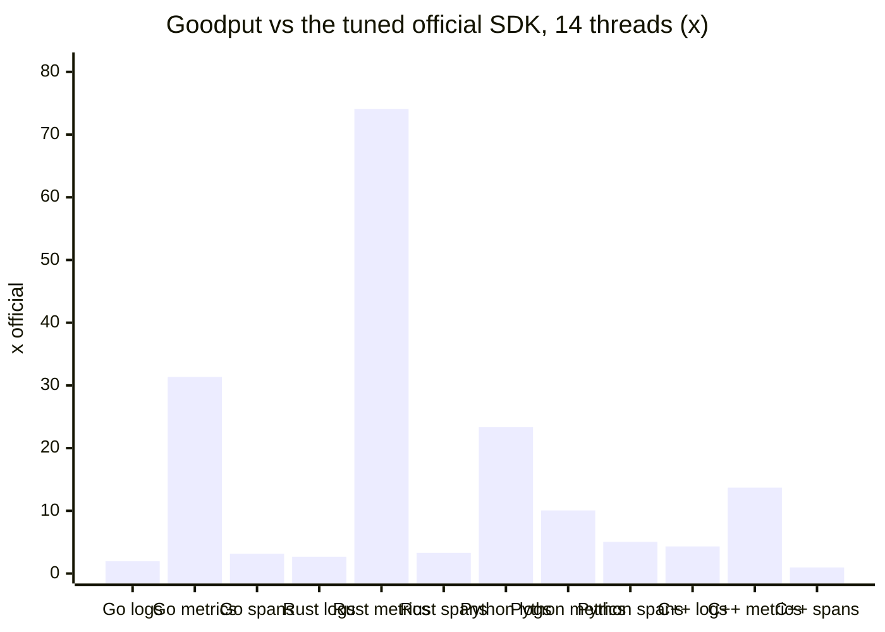

| Language | Signal | Threads | Official, tuned | This SDK | Delivered (both) | vs official |
| -------- | ------ | ------: | --------------: | -------: | ---------------: | ----------: |
| Go | logs | 1 | 558,721/s | 684,028/s | 1,000,000 / 1,000,000 | **1.22x** |
| Go | metrics | 1 | 23,776,996/s | 176,405,733/s | 1,000,000 / 1,000,000 | **7.42x** |
| Go | spans | 1 | 1,376,303/s | 2,032,417/s | 1,000,000 / 1,000,000 | **1.48x** |
| Rust | logs | 1 | 1,159,913/s | 3,051,735/s | 1,000,000 / 1,000,000 | **2.63x** |
| Rust | metrics | 1 | 109,268,719/s | 347,634,555/s | 1,000,000 / 1,000,000 | **3.18x** |
| Rust | spans | 1 | 1,787,825/s | 3,779,001/s | 1,000,000 / 1,000,000 | **2.11x** |
| Python | logs | 1 | 17,958/s | 511,734/s | 638,976 / 1,000,000 | **28.50x** |
| Python | metrics | 1 | 557,905/s | 5,469,264/s | 1,000,000 / 1,000,000 | **9.80x** |
| Python | spans | 1 | 24,419/s | 80,348/s | 974,848 / 1,000,000 | **3.29x** |
| C++ | logs | 1 | 1,355,439/s | 4,817,942/s | 1,000,000 / 1,000,000 | **3.55x** |
| C++ | metrics | 1 | 37,462,128/s | 100,895,447/s | 1,000,000 / 1,000,000 | **2.69x** |
| C++ | spans | 1 | 2,517,350/s | 2,554,923/s | 1,000,000 / 1,000,000 | **1.01x** |
| TypeScript | logs | 1 | 807,146/s | 152,819/s | 1,000,000 / 1,000,000 | **0.19x** |
| TypeScript | metrics | 1 | 24,130,813/s | 21,066,214/s | 1,000,000 / 1,000,000 | **0.87x** |
| TypeScript | spans | 1 | 584,219/s | 599,577/s | 1,000,000 / 1,000,000 | **1.03x** |
| Go | logs | 14 | 555,786/s | 1,088,855/s | 1,000,000 / 1,000,000 | **1.96x** |
| Go | metrics | 14 | 9,171,626/s | 287,500,898/s | 1,000,000 / 1,000,000 | **31.35x** |
| Go | spans | 14 | 1,011,552/s | 3,192,116/s | 1,000,000 / 1,000,000 | **3.16x** |
| Rust | logs | 14 | 1,042,218/s | 2,804,158/s | 1,000,000 / 1,000,000 | **2.69x** |
| Rust | metrics | 14 | 4,769,328/s | 353,362,135/s | 1,000,000 / 1,000,000 | **74.09x** |
| Rust | spans | 14 | 1,526,208/s | 5,036,330/s | 1,000,000 / 1,000,000 | **3.30x** |
| Python | logs | 14 | 17,388/s | 405,764/s | 696,320 / 1,000,000 | **23.34x** |
| Python | metrics | 14 | 158,457/s | 1,594,939/s | 1,000,000 / 1,000,000 | **10.07x** |
| Python | spans | 14 | 24,362/s | 122,925/s | 884,736 / 1,000,000 | **5.05x** |
| C++ | logs | 14 | 1,026,168/s | 4,437,072/s | 1,000,000 / 1,000,000 | **4.32x** |
| C++ | metrics | 14 | 27,202,188/s | 372,607,117/s | 1,000,000 / 1,000,000 | **13.70x** |
| C++ | spans | 14 | 1,367,668/s | 1,330,991/s | 1,000,000 / 1,000,000 | **0.97x** |

Under 2x: Go logs, C++ spans.
C++ spans are bounded inside opentelemetry-cpp's tracer: every span copies
reference-counted pointers that all threads share, in the official SDK and this one alike.

## At a glance

### Logs

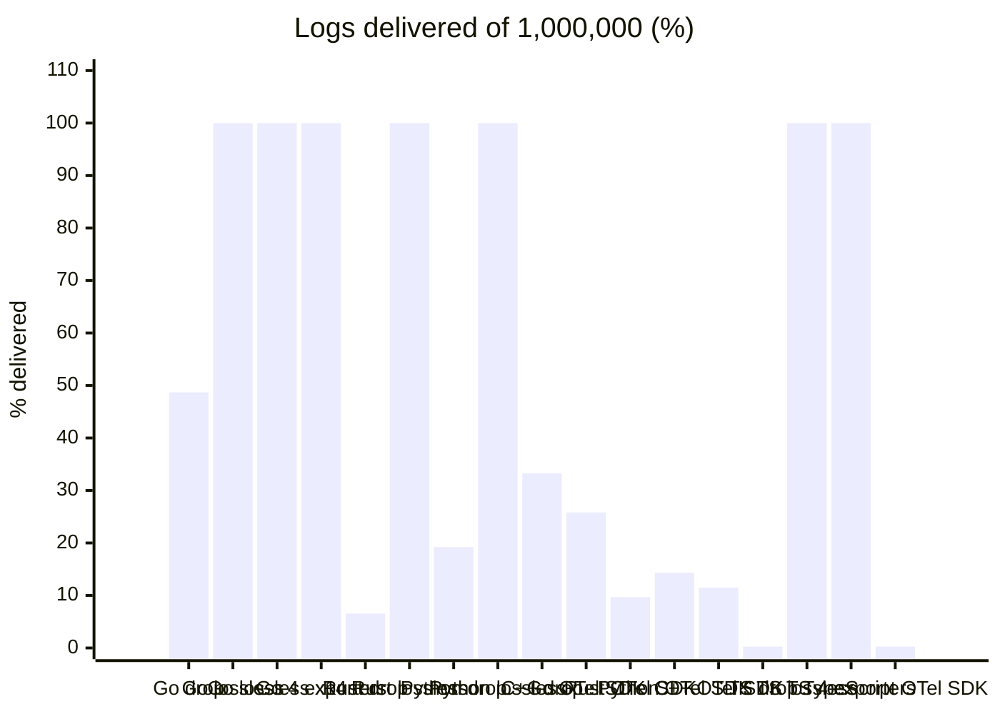

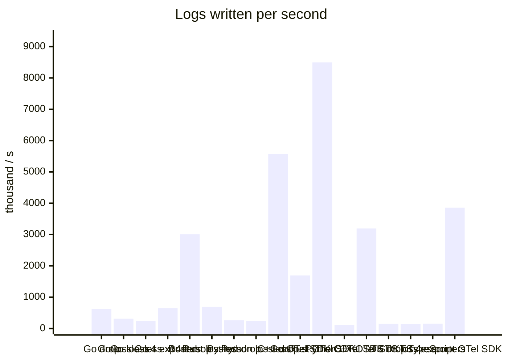

### Spans

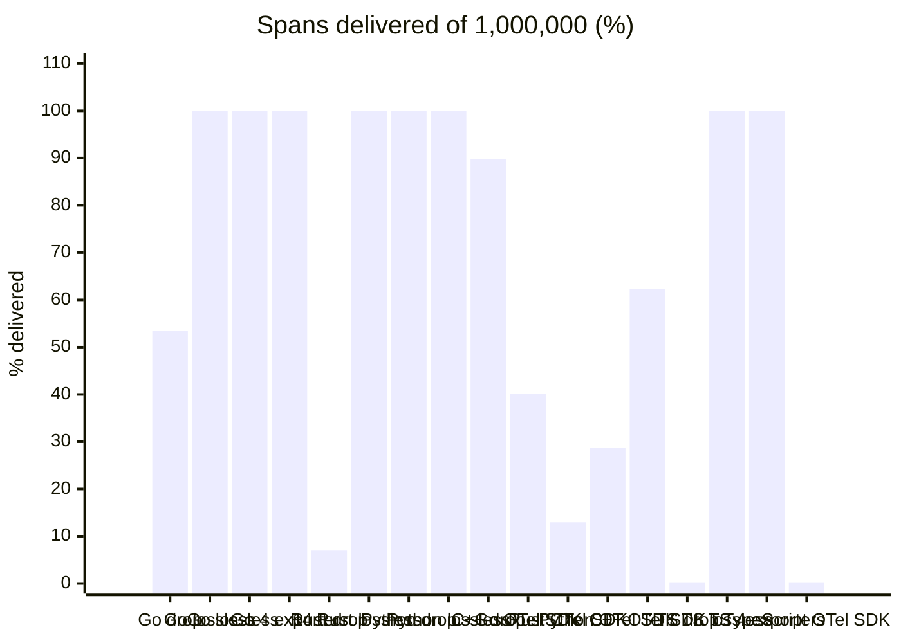

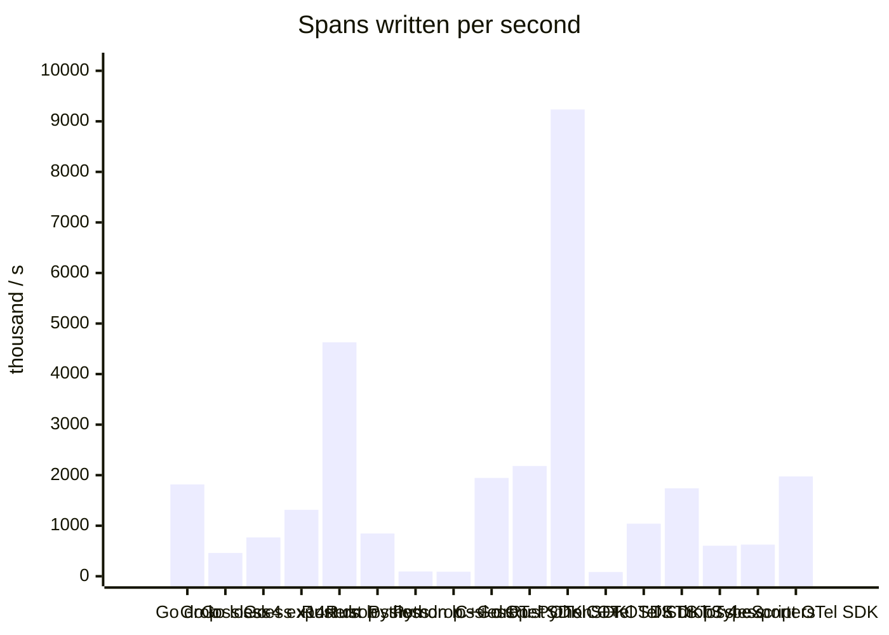

### Metrics

Every configuration delivers every increment: a counter exports its running total.

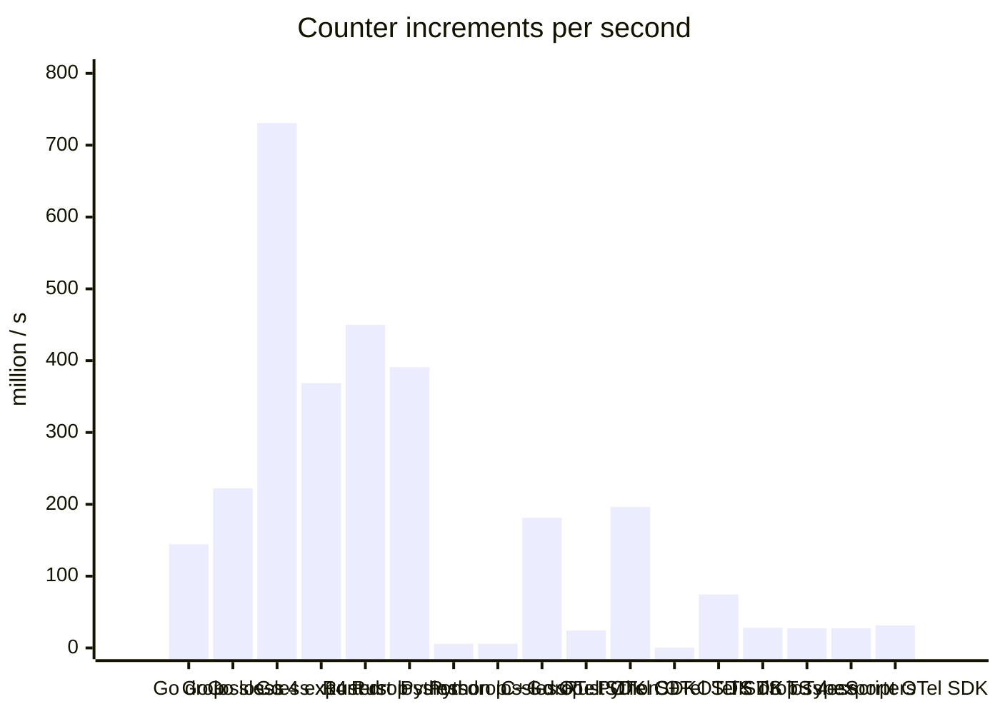

### Logs: speed against delivery

Right is faster (log scale, 1k/s to 10M/s); up is more of the records delivered.

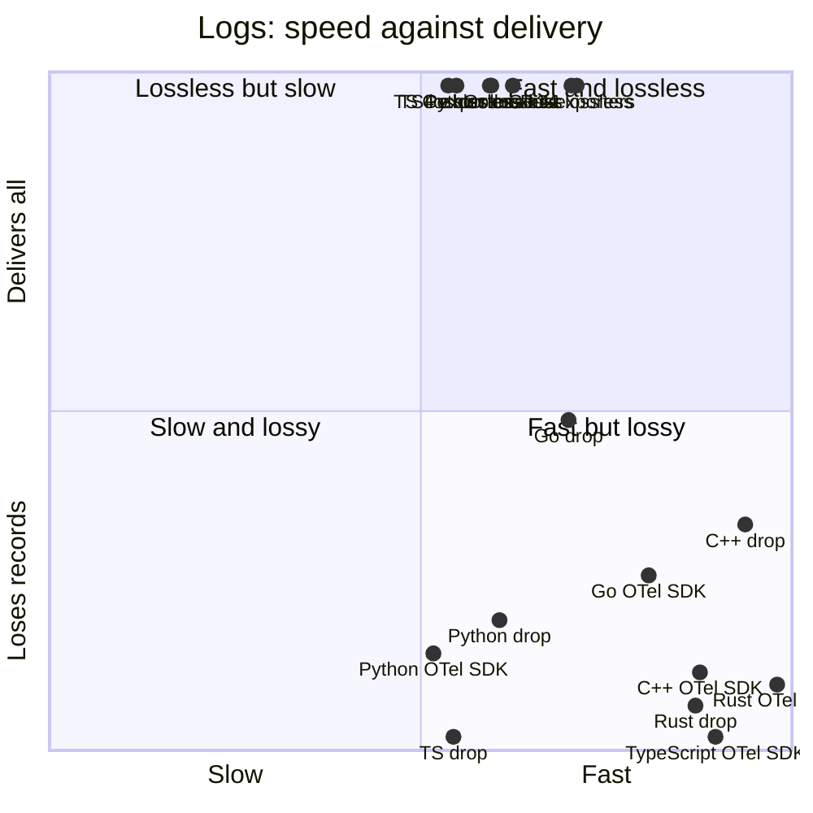

### Spans: speed against delivery

Right is faster (log scale, 1k/s to 10M/s); up is more of the records delivered.

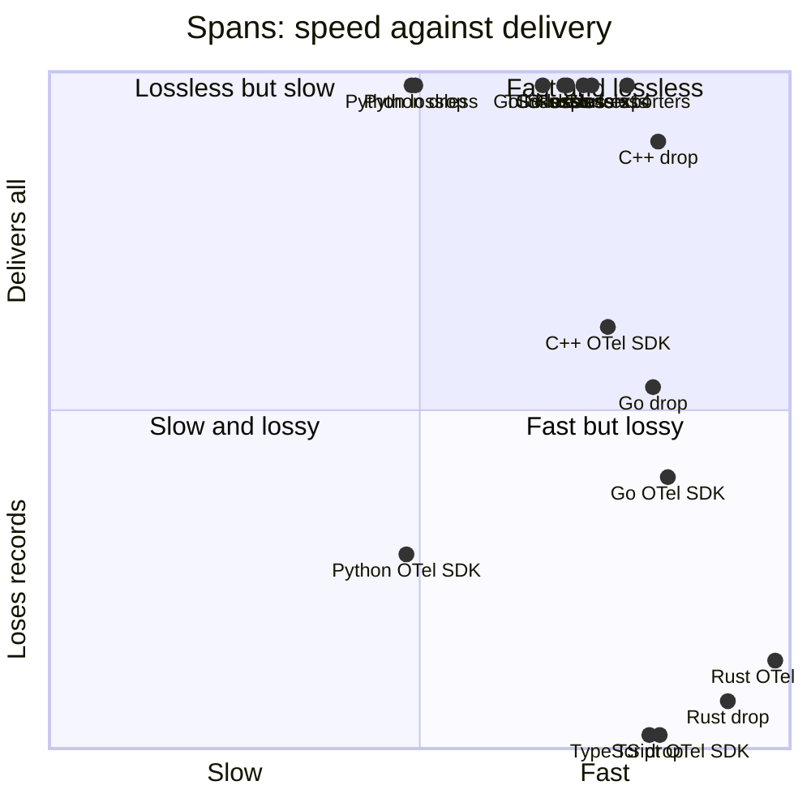

### Where the records went (default mode)

With the default drop-when-full queue, a burst faster than the collector loses what
does not fit; every SDK now counts it and reports it on close.

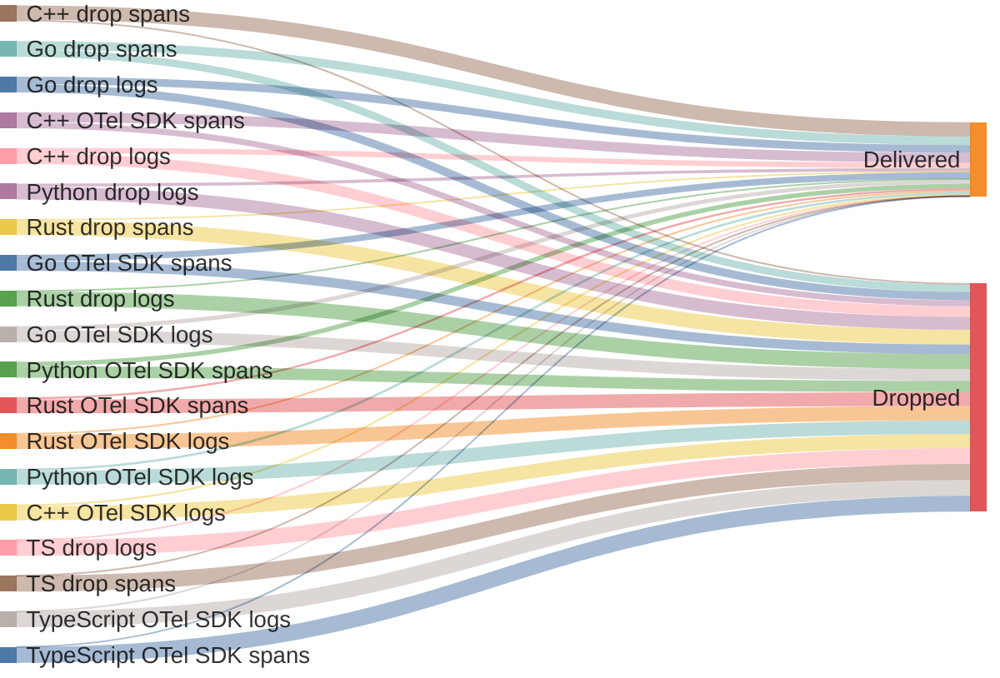

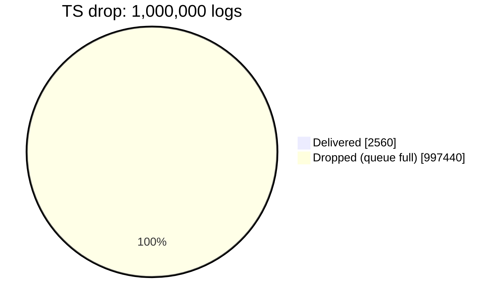

### Go: more exporters, more throughput

Measured 2026-11-16: 2,000,000 records per signal, lossless, 14 goroutines, batch 8192, to the in-process collector. Upper line spans, lower line logs (thousand / s).

```mermaid
xychart-beta
    title "Lossless throughput by number of exporters"
    x-axis "exporters" [1, 2, 4, 8]
    y-axis "thousand / s" 0 --> 4865
    line [1486, 2745, 3631, 4423]
    line [372, 792, 1514, 1572]
```

### MCAP recording

```mermaid
xychart-beta
    title "MCAP records written per second"
    x-axis ["Go logs", "Go spans", "Go metrics", "Rust logs", "Rust spans", "Rust metrics", "Python logs", "Python spans", "Python metrics", "TS logs", "TS spans", "TS metrics"]
    y-axis "thousand / s" 0 --> 2557.32
    bar [370.952, 833.3, 2324.84, 854.071, 627.361, 1871.95, 158.728, 53.54, 283.569, 126.178, 509.49, 1162.81]
```

```mermaid
xychart-beta
    title "MCAP bytes per record (zstd)"
    x-axis ["Go logs", "Go spans", "Go metrics", "Rust logs", "Rust spans", "Rust metrics", "Python logs", "Python spans", "Python metrics", "TS logs", "TS spans", "TS metrics"]
    y-axis "bytes" 0 --> 304.506
    bar [28.5632, 58.8707, 18.8336, 28.7148, 58.3581, 18.9806, 28.9151, 58.8279, 23.7279, 276.824, 223.959, 118.884]
```

### Go: cost of one call

```mermaid
xychart-beta
    title "Go SDK nanoseconds per call"
    x-axis ["LogInfo/export=false", "LogInfo/export=false-8", "LogInfo/export=true", "LogInfo/export=true-8", "Span/export=false", "Span/export=false-8", "Span/export=true", "Span/export=true-8", "Counter", "Counter-8", "CounterHandle", "CounterHandle-8"]
    y-axis "ns / op" 0 --> 1615.9
    bar [105.7, 78.14, 1469, 395.2, 113.6, 30.27, 645.7, 245.7, 15.52, 2.821, 3.82, 0.4999]
```

## OTLP export

| SDK | Mode | Signal | Delivered | Lost | Emit rate | Per call | Flush on close |
| --- | ---- | ------ | --------: | ---: | --------: | -------: | -------------: |
| Go | default (drop when full), 1 goroutine | logs | 486,812 | 51.3% | 623,101/s | 1,605 ns | 0.01 s |
| Go | default (drop when full), 1 goroutine | spans | 534,016 | 46.6% | 1,817,657/s | 550 ns | 0.00 s |
| Go | default (drop when full), 1 goroutine | metrics | 1,000,000 | 0.0% | 144,366,974/s | 7 ns | 0.00 s |
| Go | Lossless, 1 goroutine | logs | 1,000,000 | 0.0% | 312,634/s | 3,199 ns | 0.01 s |
| Go | Lossless, 1 goroutine | spans | 1,000,000 | 0.0% | 461,101/s | 2,169 ns | 0.00 s |
| Go | Lossless, 1 goroutine | metrics | 1,000,000 | 0.0% | 222,343,721/s | 4 ns | 0.00 s |
| Go | Lossless, 14 goroutines, batch 8192 | logs | 1,000,000 | 0.0% | 236,491/s | 4,228 ns | 0.23 s |
| Go | Lossless, 14 goroutines, batch 8192 | spans | 1,000,000 | 0.0% | 767,934/s | 1,302 ns | 0.06 s |
| Go | Lossless, 14 goroutines, batch 8192 | metrics | 1,000,000 | 0.0% | 730,815,722/s | 1 ns | 0.00 s |
| Go | Lossless, 14 goroutines, batch 8192, 4 exporters | logs | 1,000,000 | 0.0% | 649,714/s | 1,539 ns | 0.28 s |
| Go | Lossless, 14 goroutines, batch 8192, 4 exporters | spans | 1,000,000 | 0.0% | 1,315,179/s | 760 ns | 0.06 s |
| Go | Lossless, 14 goroutines, batch 8192, 4 exporters | metrics | 1,000,000 | 0.0% | 368,805,270/s | 3 ns | 0.01 s |
| Rust | default (drop when full) | logs | 65,528 | 93.4% | 3,008,263/s | 332 ns | 0.01 s |
| Rust | default (drop when full) | spans | 69,651 | 93.0% | 4,627,644/s | 216 ns | 0.00 s |
| Rust | default (drop when full) | metrics | 1,000,000 | 0.0% | 449,834,056/s | 2 ns | 0.01 s |
| Rust | Lossless | logs | 1,000,000 | 0.0% | 689,899/s | 1,449 ns | 0.16 s |
| Rust | Lossless | spans | 1,000,000 | 0.0% | 845,932/s | 1,182 ns | 0.06 s |
| Rust | Lossless | metrics | 1,000,000 | 0.0% | 391,051,338/s | 3 ns | 0.00 s |
| Python | default (drop when full) | logs | 192,153 | 80.8% | 264,790/s | 3,777 ns | 0.01 s |
| Python | default (drop when full) | spans | 1,000,000 | 0.0% | 94,991/s | 10,527 ns | 0.00 s |
| Python | default (drop when full) | metrics | 1,000,000 | 0.0% | 5,954,602/s | 168 ns | 0.01 s |
| Python | Lossless | logs | 1,000,000 | 0.0% | 238,830/s | 4,187 ns | 0.26 s |
| Python | Lossless | spans | 1,000,000 | 0.0% | 90,217/s | 11,084 ns | 0.03 s |
| Python | Lossless | metrics | 1,000,000 | 0.0% | 5,905,781/s | 169 ns | 0.01 s |
| C++ | default (drop when full) | logs | 332,800 | 66.7% | 5,573,032/s | 179 ns | 0.00 s |
| C++ | default (drop when full) | spans | 897,247 | 10.3% | 1,944,867/s | 514 ns | 0.00 s |
| C++ | default (drop when full) | metrics | 1,000,000 | 0.0% | 181,186,762/s | 6 ns | 0.00 s |
| Go | official OpenTelemetry SDK alone (default batch processor) | logs | 258,286 | 74.2% | 1,694,065/s | 590 ns | 0.00 s |
| Go | official OpenTelemetry SDK alone (default batch processor) | spans | 401,408 | 59.9% | 2,182,265/s | 458 ns | 0.00 s |
| Go | official OpenTelemetry SDK alone (default batch processor) | metrics | 1,000,000 | 0.0% | 24,213,710/s | 41 ns | 0.00 s |
| Rust | official OpenTelemetry SDK alone (default batch processor) | logs | 96,809 | 90.3% | 8,495,873/s | 118 ns | 0.00 s |
| Rust | official OpenTelemetry SDK alone (default batch processor) | spans | 129,558 | 87.0% | 9,235,110/s | 108 ns | 0.00 s |
| Rust | official OpenTelemetry SDK alone (default batch processor) | metrics | 1,000,000 | 0.0% | 196,397,751/s | 5 ns | 0.00 s |
| Python | official OpenTelemetry SDK alone (default batch processor) | logs | 143,383 | 85.7% | 116,530/s | 8,582 ns | 0.12 s |
| Python | official OpenTelemetry SDK alone (default batch processor) | spans | 287,232 | 71.3% | 84,713/s | 11,805 ns | 0.09 s |
| Python | official OpenTelemetry SDK alone (default batch processor) | metrics | 1,000,000 | 0.0% | 347,474/s | 2,878 ns | 0.01 s |
| C++ | official OpenTelemetry SDK alone (default batch processor) | logs | 115,003 | 88.5% | 3,193,300/s | 313 ns | 0.01 s |
| C++ | official OpenTelemetry SDK alone (default batch processor) | spans | 623,026 | 37.7% | 1,040,891/s | 961 ns | 0.00 s |
| C++ | official OpenTelemetry SDK alone (default batch processor) | metrics | 1,000,000 | 0.0% | 74,466,402/s | 13 ns | 0.00 s |
| TypeScript | default (drop when full) | logs | 2,560 | 99.7% | 150,115/s | 6,662 ns | 0.02 s |
| TypeScript | default (drop when full) | spans | 2,560 | 99.7% | 1,740,699/s | 574 ns | 0.01 s |
| TypeScript | default (drop when full) | metrics | 1,000,000 | 0.0% | 27,995,423/s | 36 ns | 0.01 s |
| TypeScript | Lossless (awaits ready()) | logs | 1,000,000 | 0.0% | 141,079/s | 7,088 ns | 0.11 s |
| TypeScript | Lossless (awaits ready()) | spans | 1,000,000 | 0.0% | 603,650/s | 1,657 ns | 0.06 s |
| TypeScript | Lossless (awaits ready()) | metrics | 1,000,000 | 0.0% | 27,352,204/s | 37 ns | 0.01 s |
| TypeScript | Lossless (awaits ready()), 4 exporters | logs | 1,000,000 | 0.0% | 155,305/s | 6,439 ns | 0.07 s |
| TypeScript | Lossless (awaits ready()), 4 exporters | spans | 1,000,000 | 0.0% | 626,243/s | 1,597 ns | 0.06 s |
| TypeScript | Lossless (awaits ready()), 4 exporters | metrics | 1,000,000 | 0.0% | 27,308,446/s | 37 ns | 0.01 s |
| TypeScript | official OpenTelemetry SDK alone (default batch processor) | logs | 2,560 | 99.7% | 3,858,102/s | 259 ns | 0.02 s |
| TypeScript | official OpenTelemetry SDK alone (default batch processor) | spans | 2,560 | 99.7% | 1,975,434/s | 506 ns | 0.01 s |
| TypeScript | official OpenTelemetry SDK alone (default batch processor) | metrics | 1,000,000 | 0.0% | 31,603,148/s | 32 ns | 0.01 s |

**Lost** is what never reached the collector. Metrics are aggregated in-process (a counter
exports its running total), so they cannot lose increments; logs and spans are exported one by
one through a bounded queue, and a queue that fills either drops (default) or makes the
program wait (lossless). Every SDK counts what it dropped and reports it on close.

## MCAP recording

The same 1,000,000 records per signal, recorded to an MCAP file for Foxglove with OTLP off,
then read back with the `mcap` library: **Recorded** is what the file holds.

| SDK | Signal | Recorded | Write rate | Per call | File size | Bytes / record |
| --- | ------ | -------: | ---------: | -------: | --------: | -------------: |
| Go | logs | 1,000,000 | 370,952/s | 2,696 ns | 27.2 MiB | 29 |
| Go | spans | 1,000,000 | 833,300/s | 1,200 ns | 56.1 MiB | 59 |
| Go | metrics | 1,000,000 | 2,324,840/s | 430 ns | 18.0 MiB | 19 |
| Rust | logs | 1,000,000 | 854,071/s | 1,171 ns | 27.4 MiB | 29 |
| Rust | spans | 1,000,000 | 627,361/s | 1,594 ns | 55.7 MiB | 58 |
| Rust | metrics | 1,000,000 | 1,871,945/s | 534 ns | 18.1 MiB | 19 |
| Python | logs | 1,000,000 | 158,728/s | 6,300 ns | 27.6 MiB | 29 |
| Python | spans | 1,000,000 | 53,540/s | 18,678 ns | 56.1 MiB | 59 |
| Python | metrics | 1,000,000 | 283,569/s | 3,526 ns | 22.6 MiB | 24 |
| TypeScript | logs | 1,000,000 | 126,178/s | 7,925 ns | 264.0 MiB | 277 |
| TypeScript | spans | 1,000,000 | 509,490/s | 1,963 ns | 213.6 MiB | 224 |
| TypeScript | metrics | 1,000,000 | 1,162,807/s | 860 ns | 113.4 MiB | 119 |

## Go: cost per call

`go test -bench . ./telemetry-go` — `export=false` is the SDK's own overhead with nothing
exported; `export=true` exports to an in-process collector. `-8` runs 8 goroutines in parallel.

| Benchmark | ns/op | B/op | allocs/op |
| --------- | ----: | ---: | --------: |
| `BenchmarkLogInfo/export=false` | 105.7 | 336 | 2 |
| `BenchmarkLogInfo/export=false-8` | 78.14 | 336 | 2 |
| `BenchmarkLogInfo/export=true` | 1469 | 1385 | 5 |
| `BenchmarkLogInfo/export=true-8` | 395.2 | 1599 | 9 |
| `BenchmarkSpan/export=false` | 113.6 | 240 | 5 |
| `BenchmarkSpan/export=false-8` | 30.27 | 240 | 5 |
| `BenchmarkSpan/export=true` | 645.7 | 1140 | 7 |
| `BenchmarkSpan/export=true-8` | 245.7 | 1290 | 8 |
| `BenchmarkCounter` | 15.52 | 0 | 0 |
| `BenchmarkCounter-8` | 2.821 | 0 | 0 |
| `BenchmarkCounterHandle` | 3.820 | 0 | 0 |
| `BenchmarkCounterHandle-8` | 0.4999 | 0 | 0 |
